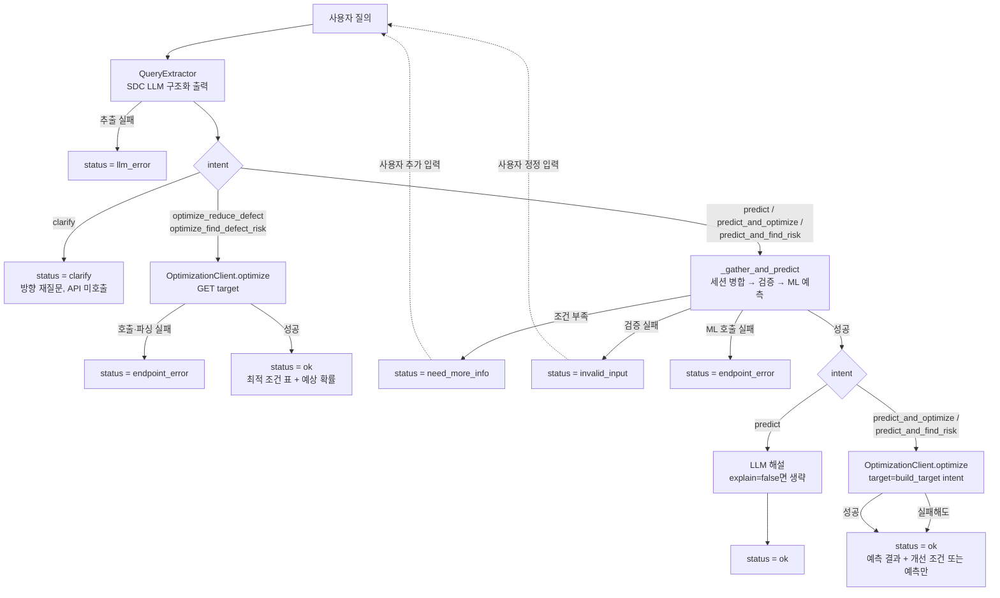

# 아키텍처 (Architecture)

사용자의 자연어 질의에서 의도(intent)와 공정 입력값을 추출해, 의도에 따라 **결함률 예측 API**(기존 AIHUB 파이프라인) 또는 **공정 최적화 API**(신규)를 호출하고, 결과를 LLM 해설 또는 결정적 서식으로 응답하는 파이프라인입니다.

> 이 문서는 `aihub/` 소스(`llm.py`, `schema.py`, `pipeline.py`, `optimization.py`, `ml.py`, `config.py`)를 읽고 작성했으며, **실제 LLM/예측 API/최적화 API를 호출해 검증한 결과는 아닙니다.** 서로 다른 설계를 제안한 명세서 2종(`docs/agent-v2/`) 중 실제 코드와 일치하는 쪽은 [`bak/chatbot_optimization_feature_spec.md`](agent-v2/bak/chatbot_optimization_feature_spec.md)입니다(**[수정] 경로 정정**: 이 문서의 이전 버전은 `agent-v2/pre-version/...` 경로를 가리켰으나 `pre-version/` 디렉터리는 존재하지 않고 실제 경로는 `bak/`입니다 — `AIHUB-v2/docs/code_inventory.md`·`README.md`가 먼저 바로잡은 내용과 동일). 단 `predict_and_find_risk` 의도는 이 명세서에 **없는**, 이후 추가된 의도입니다(4.1·4.4·8절 참고).


## 1. 개요

| 항목 | 내용 |
|---|---|
| 목적 | 자연어 질의 → (1) 결함률(%) 예측/해설, 또는 (2) 불량·정상 확률을 최적화하는 공정 조건 추천 |
| 입력 | 사용자 질의 (한국어/영어, 자연어·키=값·구어체·JSON 붙여넣기 등) |
| 중간 산출물 | `intent`(`schema.INTENTS` 6종 중 하나) + 12개 컬럼으로 구성된 JSON 레코드(`{"data": [...]}`, predict 계열일 때만) |
| 출력 | 의도에 따라 (a) `prediction(defect_rate_pct)` 예측값(%) + LLM 해설, (b) 최적화 API가 돌려준 최적 조건 12개 + 예상 확률, 또는 (c) 방향을 되묻는 고정 문구 |
| 핵심 원칙 | (기존과 동일) 질의에 명시되지 않거나 **모호한** 값은 **추측하지 않고** `null` 처리, 누락·모호 시 **API를 호출하지 않고 되묻기**. 최적화 의도는 조건이 없어도 호출되지만, **의도→target 변환은 LLM이 아니라 코드가 고정 사전으로 수행**(환각 방지) |

## 2. 전체 흐름 (텍스트)

```text
사용자 질의
   │
   ▼
[QueryExtractor]  SDC LLM 구조화 출력 (json_schema → json_object → prompt 폴백)
   │  · 12개 필드 추출 (기존과 동일: 추측 금지, 모호값 처리, 다중 레코드 분리 등)
   │  · [신규] intent 동시 추출: predict / optimize_reduce_defect / optimize_find_defect_risk /
   │             predict_and_optimize / predict_and_find_risk / clarify 중 하나(6종). 스키마 enum 밖·누락 값은 코드가 "clarify"로 대체
   │        └─ LLM 호출·파싱 실패 → status=llm_error (intent 문제에도 동일)
   ▼
[DefectRatePipeline.run()] intent로 분기 — 아래 5개 경로 중 하나로
   │
   ├─ intent = clarify
   │     └─ 어떤 API도 호출하지 않고 방향을 되묻는 고정 문구 반환 → status=clarify
   │
   ├─ intent = optimize_reduce_defect | optimize_find_defect_risk  (조건 입력 불필요)
   │     │  target = build_target(intent)  (고정 사전: 불량최소화→"1", 위험탐색→"0")
   │     ▼
   │  [OptimizationClient.optimize] GET $OPTIMIZATION_API_URL?target=... (재시도 + 타임아웃)
   │     ├─ 호출·파싱 실패 → status=endpoint_error
   │     └─ 성공 → 최적 조건 Markdown 표 + 예상 확률 → status=ok (ML/LLM 미호출)
   │
   └─ intent = predict | predict_and_optimize | predict_and_find_risk  (조건 입력 필요, 기존 AIHUB와 동일한 결로)
         ▼
      [_gather_and_predict] 공통 단계 (아래 4.3절)
         │  · SlotFillingSession.merge: 이전 턴의 확인값과 병합
         │  · validate_provided_fields: 값이 있는 필드만 개별 검증 (슬롯이 덜 차도 실행)
         │  · DefectRateInput: 12개 모두 찼을 때 최종 타입·범위 검증
         ├─ 누락·모호 필드 있음 → status=need_more_info (API 미호출)
         ├─ 허용값·범위 위반 → status=invalid_input (API 미호출)
         ▼
      {"data": [ {12개 컬럼}, ... ]}
         ▼
      [DefectRateMLClient.predict] POST $AI_HUB_ENDPOINT_URL (재시도 + 타임아웃 + 에코 검증)
         ├─ 호출·응답 검증 실패 → status=endpoint_error
         ▼
      predictions: [1.6498…, ...] (단위 %)
         │
         ├─ intent = predict
         │     └─ LLM 해설(선택, explain=false면 생략) → status=ok
         │
         └─ intent = predict_and_optimize | predict_and_find_risk
               │  target = build_target(intent)  (predict_and_optimize→"1" 불량 최소화 /
               │             predict_and_find_risk→"0" 위험 조건 탐색 — [추가] 2026-10-29, 명세서엔 없음)
               ▼
            [OptimizationClient.optimize] (위와 동일. _run_predict_and_optimize가 두 의도를 함께
               처리하도록 일반화됨 — [수정] 2026-10-29 소스 docstring으로 직접 확인(8절 9번 참고)
               ├─ 실패해도 예측 결과는 그대로 반환 (부분 성공, optimization=null + errors에 사유 기록)
               └─ 성공 → 예측치 + 조건 표(개선 또는 위험, intent에 따라 다름) → status=ok
```

## 3. 흐름도 (Mermaid)



## 4. 컴포넌트 상세

### 4.1 QueryExtractor — 조건 추출과 의도(intent) 분류

조건 추출 로직(추측 금지, 모호값 null 처리, 단위 환산, 항목명 없는 값 매칭, 다중 레코드 분리 등)은 AIHUB와 동일합니다. 자세한 규칙은 `llm.py`의 `EXTRACTION_SYSTEM_PROMPT`를 참고하세요. 이 절은 v2에서 **추가된 의도 분류**만 다룹니다.

- 추출 요청 한 번(`QueryExtractor.extract()`)으로 12개 필드와 `intent`를 **동시에** 받습니다. 별도의 LLM 호출이 추가되지 않습니다.
- 프롬프트의 `[의도 분류 — intent]` 절이 6개 의도의 정의와 예시를 제공합니다(`predict`, `optimize_reduce_defect`, `optimize_find_defect_risk`, `predict_and_optimize`, `predict_and_find_risk`, `clarify`). **[추가] 2026-10-29 (소스 확인)**: `predict_and_find_risk`(예: "이 조건 결함률 예측하고, 불량이 더 심해지는 위험 조건도 알려줘")는 `docs/agent-v2/bak/chatbot_optimization_feature_spec.md`에는 없는, 이후 추가된 의도입니다(`AIHUB-v2/README.md` "배경" 절 참고).
- 프롬프트는 LLM에게 **target 숫자(0/1)를 직접 고르지 말라고 명시**합니다("intent만 고르면 시스템이 변환한다"). 실제 변환은 4.4절의 `build_target()`이 코드로 수행합니다.
- **안전장치**: `json_object`/`prompt` 폴백 모드에서는 서버가 스키마를 강제하지 않으므로 `intent` 키가 없거나 `INTENTS` 밖의 문자열이 올 수 있습니다. `QueryExtractor.extract()`는 이 경우를 `"clarify"`로 대체합니다(`intent = raw_intent if raw_intent in INTENTS else "clarify"`). 즉 **의도 분류가 실패해도 최적화 API가 잘못된 target으로 호출되는 일은 없고**, 사용자에게 방향을 되묻는 쪽으로 안전하게 수렴합니다.
- `optimize_reduce_defect`/`optimize_find_defect_risk` 의도에서는 `records`가 비어 있어도 됩니다(프롬프트에 명시). 이 두 의도는 최적화 API가 조건 자체를 찾아 주므로 사용자 입력이 필요 없기 때문입니다.

### 4.2 intent 라우팅 — `DefectRatePipeline.run()`

```python
intent = extraction.intent
if intent == "clarify":
    return self._run_clarify()
if intent in ("optimize_reduce_defect", "optimize_find_defect_risk"):
    return self._run_optimize_only(intent)
if intent in ("predict_and_optimize", "predict_and_find_risk"):
    return self._run_predict_and_optimize(extraction, session, intent)
# intent == "predict"
return self._run_predict(query, extraction, session, explain)
```

> ✅ **[확인 완료] 2026-10-29**: 위 스니펫은 실제 `pipeline.py` 소스(`_run_predict_and_optimize(self, extraction, session, intent)` 시그니처 포함)로 직접 대조해 정확함을 확인했습니다. 내부에서 `build_target(intent)`를 호출해 target을 동적으로 결정하며, 과거에는 `"predict_and_optimize"` 문자열과 `target="1"`이 하드코딩돼 있어 반대 방향 요청을 표현할 수 없었다는 배경이 메서드 docstring에 명시돼 있습니다.

| intent | 처리 메서드 | 호출 API | 비고 |
|---|---|---|---|
| `predict` | `_run_predict` | 예측 API (+LLM 해설) | 리팩터링 이전과 동작 동일 |
| `optimize_reduce_defect` | `_run_optimize_only("optimize_reduce_defect")` | 최적화 API만 | target="1", 예측/해설 없음 |
| `optimize_find_defect_risk` | `_run_optimize_only("optimize_find_defect_risk")` | 최적화 API만 | target="0", 예측/해설 없음 |
| `predict_and_optimize` | `_run_predict_and_optimize` | 예측 API + 최적화 API | target=`build_target(intent)`="1"(불량 최소화), 예측 성공 후에만 최적화 호출 |
| `predict_and_find_risk` | `_run_predict_and_optimize` | 예측 API + 최적화 API | target=`build_target(intent)`="0"(위험 조건 탐색). **[추가] 2026-10-29**, 명세서엔 없는 의도. `predict_and_optimize`와 메서드를 공유하도록 일반화됨(README.md 서술 기준) |
| `clarify` | `_run_clarify` | 없음 | 고정 문구만 반환 |

### 4.3 예측 공통 경로 — `_gather_and_predict`

`predict`와 `predict_and_optimize` 두 의도가 공유하는 단계로, AIHUB의 예측 파이프라인을 그대로 옮긴 것입니다(로직 변경 없음, 함수로만 추출).

1. **빈 입력 처리**: `records`가 비어 있고 세션에도 확인값이 없으면 ML을 호출하지 않고 12개 필드 전체를 되묻습니다(`no_conditions=True`).
2. **모호 필드 초기화**: 이미 세션에 확인된 필드를 이번 발화가 모호하게 재언급하면(`ambiguous_fields`), 해당 슬롯을 세션에서 먼저 비워 기존 값으로 조용히 예측되는 것을 막습니다.
3. **값 단위 사전 검증**(`validate_provided_fields`): 슬롯이 12개 모두 차기 전에도, 값이 있는 필드는 즉시 검증합니다. 위반 필드는 `null`로 바꿔 세션에 저장하지 않고 `invalid_input`으로 응답합니다.
4. **세션 병합**(`SlotFillingSession.merge`): 레코드별로 세션의 기존 값과 이번 발화 값을 병합합니다. 레코드 간 값이 다르면 공통 슬롯에는 저장하지 않습니다.
5. **누락 검사**: 병합 결과 중 하나라도 `null`인 필드가 있으면 `need_more_info`로 되묻습니다.
6. **최종 검증**(`DefectRateInput`): 12개가 모두 찬 레코드에 대해 Pydantic으로 최종 타입·범위·허용값을 검사합니다(3번 사전 검증을 통과한 뒤의 안전망).
7. **ML 호출**(`DefectRateMLClient.predict`): 검증을 통과한 레코드만 예측 API로 전송합니다.

**입력 필드 제약** (`schema.py` 기준, AIHUB와 동일):

| 필드 | 제약 |
|---|---|
| `production_line` | `LINE-BPR-01`, `LINE-BPR-02` 중 하나 |
| `shift` | `DAY`, `NIGHT` 중 하나 |
| `supplier_code` | `SIM-SUP-A`, `SIM-SUP-B`, `SIM-SUP-C` 중 하나 |
| `planned_quantity` | 0 이상 (정수) |
| `ambient_humidity_pct` | 0~100 |
| `incoming_material_quality_score` | 0~100 |
| `coating_target_thickness_um` | 0 이상 |
| `weld_energy_setting_pct` | 0~150 |
| `fixture_alignment_offset_mm` | 0 이상 |
| `process_setting_deviation_pct` | 제약 없음 (음수 허용) |
| `tool_wear_pct` | 0~100 |
| `days_since_maintenance` | 0 이상 (정수) |

> ⚠️ **확인 필요**: `schema.py` 주석은 이 중 화이트리스트 3종과 `fixture_alignment_offset_mm>=0`, `tool_wear_pct` 0~100만 "사양 확정" 하드 제약이라 하고, 나머지(수량·습도·품질점수·용접·두께·경과일 범위)는 "사양에 없는 물리적 타당성 검사"라고 적어 두었습니다. 이 구분의 근거 문서로 `docs/input_schema.md`를 언급하지만 **이 저장소(`AIHUB-v2/docs/`)에는 해당 파일이 없습니다**(AIHUB 쪽에도 같은 경로에는 없고 `AIHUB/docs/agent-v1/`과 `AIHUB/docs/bak/`에 과거 버전만 있습니다). 어떤 제약이 실제 사양인지는 담당자 확인이 필요합니다.

### 4.4 최적화 API 연동 — `OptimizationClient`

AIHUB에는 없던 신규 모듈(`aihub/optimization.py`)입니다. 기존 `ml.py`(POST, 조건→결함률 예측)와는 호출 방식과 의미가 다릅니다.

| 구분 | `DefectRateMLClient` (ml.py) | `OptimizationClient` (optimization.py) |
|---|---|---|
| 메서드 | POST | GET |
| 요청 | `{"data": [12개 컬럼, ...]}` (조건을 보냄) | 쿼리 파라미터 `target`(`"0"`/`"1"`)만 보냄 (조건을 요청함) |
| 의미 | "이 조건의 결함률은?" | "이 라벨이 나올 확률을 최소화하는 조건은?" |
| 응답 | 레코드별 `prediction(defect_rate_pct)` | 조건 12개 + `confidence(1)`/`confidence(0)`/`prediction(high_defect_flag)` |

**intent → target 매핑** (`INTENT_TO_TARGET`, `build_target()`):

| intent | target | 의미 |
|---|---|---|
| `optimize_reduce_defect` | `"1"` | 불량(high_defect_flag=1) 확률 최소화 조건 |
| `predict_and_optimize` | `"1"` | 위와 동일 (항상 불량 최소화 방향) |
| `optimize_find_defect_risk` | `"0"` | 정상(=0) 확률 최소화 = 불량 유발(위험) 조건 |
| `predict_and_find_risk` | `"0"` | 위와 동일 (항상 위험 조건 탐색 방향) — **[추가] 2026-10-29**, 명세서엔 없는 의도(소스 확인: `optimization.py`의 `INTENT_TO_TARGET`) |

> 📌 **부분 검증 근거**: `docs/agent-v2/aistudio_optimization_troubleshooting.md` 4절의 실제 `curl` 기록에서 `target=1`은 `confidence(1)`(불량 확률)을, `target=0`은 `confidence(0)`(정상 확률)을 각각 약 1.7%로 최소화했습니다. 이는 "target은 `confidence(target)`를 최소화한다"는 `INTENT_TO_TARGET` 해석과 **일치하는 정황 증거**입니다. 다만 개발 단계 테스트일 뿐 챗봇 전체 흐름(intent 분류 → target 변환 → 포맷팅)의 검증은 아니며, 자동 테스트(`test/test_optimization.py`)도 **저장소에 없습니다**(8절 참고).
<!-- [수정] 2026-10-29: 문서 길이 축소를 위해 문장을 요약함(서술 압축만 했고 사실 관계는 변경 없음) -->

**응답 파싱** (`parse_optimization_response()`): `{"data": [{...}]}`를 기대하며, `data[0]`에서 `confidence(1)`/`confidence(0)`/`prediction(high_defect_flag)`을 뺀 나머지 키를 모두 "최적 조건"으로 간주합니다. 조건 키 이름이 바뀌면 자동으로 새 조건에 포함되고, 신뢰도 필드 이름이 바뀌면 `KeyError`로 `OptimizationEndpointError`가 발생합니다.

**재시도 정책**: `ml.py`와 같이 5xx·타임아웃·네트워크 오류만 재시도하고(`optimization_max_retries`, 기본 1회), 4xx는 즉시 실패 처리합니다. 기본 타임아웃은 180초로 예측 API(30초)보다 길며, `curl_test_classification.sh`의 `--max-time 180`에서 추정한 값입니다.

### 4.5 결과 포맷팅과 고지 문구

최적화 결과는 LLM 해설 없이 **코드가 결정적으로** Markdown을 생성합니다(수치 환각 방지, 명세 6.3절).

- `_format_conditions_table(conditions)`: 조건 dict를 `ALL_FIELDS` 순서(없는 키는 뒤에 추가)로 정렬해 2열 표(`| 항목 | 값 |`)로 만듭니다. `shift`는 `_SHIFT_DISPLAY = {"DAY": "주간 (DAY)", "NIGHT": "야간 (NIGHT)"}`로 변환하고, 정의되지 않은 코드는 원문 그대로 표시합니다. **[수정] 2026-10-29**: 2026-10-27 수정으로 "비고" 열이 제거되어 `UNCONTROLLABLE_FIELDS`를 더 이상 쓰지 않으므로("참고값" 안내를 덧붙인다는 이전 서술은 오류), docstring에 "import 정리 필요" 메모가 남아 있습니다.
- `_format_optimize_only(intent, result)`: 의도별 제목("불량 확률 최소화"/"위험 조건"), 조건 표, 예상 불량·정상 확률(%), "참고값" 안내, 모델 추정 고지를 출력합니다. ⚠️ **알려진 불일치**: 표에서 참고값 표시가 사라져 "참고값으로 표시된 항목…" 문구가 표와 맞지 않습니다(docstring의 "함께 검토 필요" TODO).
- `_format_predict_and_optimize(predictions, optimization, optimization_error, intent)`: 현재 조건의 예측 결함률을 먼저 보여줍니다. `intent == "predict_and_find_risk"`(`is_risk`)이면 제목(`"위험 조건입니다"`/`"개선 조건입니다"`), 확률 라벨(`"위험 조건 적용 시 예상 불량 확률"`/`"개선 조건 적용 시 예상 불량 확률"`), 실패 문구(`"위험 조건 계산"`/`"개선 조건 계산"`)가 달라집니다.
  - `confidence(1)`(`defect_probability`)은 두 방향 모두 "예상 불량 확률"로 표시하며, 위험 조건 탐색(`target="0"`)에서는 값이 높은 것이 정상입니다.
  - `normal_probability`와 "참고값" 안내는 표시하지 않습니다(`_format_optimize_only`와 구성이 다름).
  - 최적화 실패 시에는 고지 문구 없이 "실패했습니다: {사유}" 한 줄만 덧붙입니다(부분 성공 허용).

`PipelineResult.optimization`에는 `parse_optimization_response()`의 원본 결과(`conditions`, `defect_probability`, `normal_probability`, `predicted_label`, `latency_ms`, `target`)가 그대로 담겨 `/chat/predict` 응답에도 포함됩니다. 즉 `answer`(Markdown)와 `optimization`(구조화 데이터)이 같은 정보를 두 형태로 제공합니다.

### 4.6 해설 생성 — `_explain` (predict 전용)

예측 경로(`_run_predict`)에서만 사용하며 AIHUB와 동일합니다. `predict_and_optimize`와 `optimize_*` 경로는 `_explain`을 호출하지 않고 4.5절의 결정적 포맷팅만 사용합니다. 즉 **최적화 결과에는 LLM이 전혀 관여하지 않습니다**(수치를 지어낼 가능성을 원천 차단).

## 5. 상태(Status) 정의

`Status = Literal["ok", "need_more_info", "invalid_input", "endpoint_error", "llm_error", "clarify"]` (`pipeline.py`). 모두 HTTP 200으로 전달될 수 있으므로 **HTTP 성공을 처리 성공으로 판단하면 안 됩니다**.

| status | 발생 시점 | 해당 intent | API 호출 여부 |
|---|---|---|---|
| `ok` | 예측 또는 최적화 성공 | 모든 intent (`clarify` 제외) | 성공 |
| `need_more_info` | 조건 누락·모호 | `predict`, `predict_and_optimize`, `predict_and_find_risk` | 미호출 |
| `invalid_input` | 허용값·범위 위반 | `predict`, `predict_and_optimize`, `predict_and_find_risk` | 미호출 |
| `endpoint_error` | 예측/최적화 API 호출·응답 검증 실패(아래 각주 참고) | `predict`·`optimize_reduce_defect`·`optimize_find_defect_risk` 전체, `predict_and_optimize`/`predict_and_find_risk`는 **ML 예측 호출 실패 시에만** | 호출했으나 실패 |
| `llm_error` | 추출 LLM 호출·파싱 실패, 또는 `_run_optimize_only`의 `build_target` 내부 분기 오류([확인 필요], 아래 참고) | 모든 intent | 미호출 |
| `clarify` | 최적화 의도는 있으나 방향 불분명 | `clarify` | 미호출 |

## 6. intent별 동작 요약

| intent | 조건 입력 필요 | 호출 API | LLM 해설 | 세션 영향 | 대표 `status` |
|---|---|---|---|---|---|
| `predict` | 필요 | 예측 API | 있음(선택) | 병합·검증된 값을 저장(turn 증가) | `ok` / `need_more_info` / `invalid_input` / `endpoint_error` |
| `predict_and_optimize` | 필요 | 예측 API + 최적화 API | 없음(결정적 포맷만) | 위와 동일 | 위와 동일 |
| `predict_and_find_risk` | 필요 | 예측 API + 최적화 API | 없음(결정적 포맷만) | 위와 동일 | 위와 동일 — **[추가] 2026-10-29**, 명세서엔 없는 의도 |
| `optimize_reduce_defect` | 불필요 | 최적화 API만 | 없음 | **영향 없음**(세션 메서드 미호출) | `ok` / `endpoint_error` |
| `optimize_find_defect_risk` | 불필요 | 최적화 API만 | 없음 | 위와 동일 | `ok` / `endpoint_error` |
| `clarify` | 해당 없음 | 없음 | 없음 | 위와 동일 | `clarify` |

## 7. 세션과 멀티턴

`SlotFillingSession`은 AIHUB와 동일한 구조(`slots`, `turn`, `last_missing`, `repeated_asks`)이며 서버 프로세스 메모리에만 저장되고 재시작하면 사라집니다(만료·영속 저장·워커 간 공유 없음).

- `DefectRatePipeline.run()`은 intent와 무관하게 **매번 `session.known()`을 추출 맥락으로 LLM에 전달**합니다. 즉 이전 턴에서 `predict`로 확인된 값은 이번 턴이 `optimize_*`여도 추출 단계에 맥락으로 전달됩니다.
- 하지만 **세션 쓰기(merge, track_missing, turn 증가)는 `_gather_and_predict` 경로(`predict`, `predict_and_optimize`, `predict_and_find_risk`)에서만 일어납니다**. `optimize_reduce_defect`/`optimize_find_defect_risk`/`clarify`는 세션을 읽기만 하고 쓰지는 않습니다(`session.merge()`가 호출되지 않아 `turn`도 증가하지 않음).
- 실제 영향: 사용자가 조건을 한참 입력하다가(`predict`) 중간에 "불량 줄이는 조건 알려줘"(`optimize_reduce_defect`)를 물어도 기존에 확인된 슬롯은 그대로 남고, 다음 발화에서 다시 `predict`로 돌아오면 이전 슬롯이 그대로 효력을 가집니다. 이 동작은 코드로는 확인했으나 실행으로 재확인하지는 않았습니다.
- 모호 필드 재설정(기존 확인값을 다시 모호하게 바꾸려는 발화), 허용값 밖 코드 처리 등 `predict` 경로의 세부 규칙은 AIHUB와 동일하게 유지됩니다.

## 8. 미결 사항 / 확인 필요

소스를 읽다 발견한 사실을 수정 없이 기록합니다(`AIHUB-v2/README.md` "알려진 문제"와 겹치는 항목은 요약만 담음). <!-- [수정] 문서 길이 축소를 위해 각 항목을 요약함(서술 압축만 했고 사실 관계는 변경 없음) -->
1. **`INTENT_TO_TARGET` 매핑은 부분 검증만 됨** (4.4절): `aistudio_optimization_troubleshooting.md`의 `curl` 기록이 해석을 뒷받침하지만 개발 단계 테스트일 뿐 자동 테스트로 고정되지 않았습니다. 매핑이 틀리면 "불량 줄이기"와 "위험 조건 찾기" 응답이 뒤바뀔 수 있습니다.
2. **자동(단위) 테스트 부재**: 팀이 pytest 사용을 중단해(`requirements.txt`, `pyproject.toml`에서 제거) `INTENT_TO_TARGET`을 고정하는 자동 안전망이 없습니다. 수동 스모크 테스트(`test/cli_smoke_test.sh`, `test/web_smoke_test.sh`)로 일부만 확인합니다.
3. **웹 UI 최적화 조건 렌더링 부재**: 2026-10-28 수정으로 `app.js`가 `clarify`와 intent별 상태 문구, `optimization.latency_ms`를 처리합니다. 그러나 `optimization`의 최적 조건 12개를 전용 영역·표로 보여주는 기능은 없고, `answer`(Markdown)와 `raw` JSON에서만 확인할 수 있습니다(`code_inventory.md` 참고).
4. **`/health`가 최적화 설정 여부를 노출하지 않음**: `optimization_api_url` 설정 상태를 웹 UI에서 확인할 수 없습니다.
5. **`UNCONTROLLABLE_FIELDS`는 현재 비활성화됨**: `aistudio_optimization_troubleshooting.md` 6절의 "검토 필요" 항목에서 가져온 제안 단계 가정이었습니다. 담당자가 2026-10-29에 비활성화를 직접 확인했으며, "참고값" 표시가 제거된 것(4.5절)과 일관됩니다.
6. **최적화 API 설정 값 미검증**: `optimization_timeout_seconds`(180초)와 `optimization_max_retries`(1회)는 `curl_test_classification.sh`의 `--max-time`에서 추정한 값입니다. 실제 응답 시간과 인증 필요 여부는 `optimization.py` docstring이 "검증되지 않았다"고 명시합니다.
7. **`docs/input_schema.md` 참조 깨짐**: `schema.py` 주석이 이 파일을 근거로 들지만 저장소에 없습니다(4.3절). AIHUB 복사 시 주석만 옮겨진 것으로 추정됩니다.
8. **`predict_and_optimize`의 부분 성공 노출**: 최적화가 실패해도 `status`는 `ok`이고 사유는 `errors`에만 남습니다. 클라이언트가 `errors`를 강조하지 않으면 사용자가 부분 실패를 놓칠 수 있습니다.
9. **`predict_and_find_risk` 관련 확인 완료 (2026-10-29)**: 이 의도는 `chatbot_optimization_feature_spec.md`에 없는 추가 의도입니다. 사용자가 제공한 `pipeline.py` 조각(전체 파일을 도구로 열람한 것은 아님)과 `schema.py`·`optimization.py`·`llm.py`·`cli.py`·`web/app.js`를 대조해 확인했습니다.
   - (a) `_run_predict_and_optimize(self, extraction, session, intent)`가 `build_target(intent)`로 target을 정하고 `_format_predict_and_optimize(..., intent)`를 호출합니다.
   - (b) `_format_predict_and_optimize`는 `is_risk`에 따라 제목·확률 라벨·실패 문구를 실제로 다르게 렌더링합니다(4.5절).
   - (c) `_format_conditions_table`은 2026-10-27 수정으로 "참고값" 표시가 제거된 2열 표입니다. 따라서 "UNCONTROLLABLE_FIELDS에 참고값 안내를 덧붙인다"는 이전 서술은 틀렸습니다.
   - (d) `_format_optimize_only`의 "※ 참고값으로 표시된 항목은..." 문구는 (c) 때문에 표와 맞지 않습니다(코드 docstring의 "함께 검토 필요" TODO).
   - `_SHIFT_DISPLAY` 매핑과 `UNCONTROLLABLE_FIELDS` 비활성화도 확인해, `pipeline.py` 포맷 로직에 남은 미확인 사항은 없습니다(4.5절 참고).

## 9. 관련 문서

| 문서 | 내용 |
|---|---|
| [`../README.md`](../README.md) | 설치·설정·실행·알려진 문제 |
| [`code_inventory.md`](code_inventory.md) | 파일별 역할 목록 |
| [`agent-v2/bak/chatbot_optimization_feature_spec.md`](agent-v2/bak/chatbot_optimization_feature_spec.md) | 실제 코드와 대체로 일치하는 최적화 기능 명세서(통합형). **[수정] 경로 정정**: 이전 버전은 `pre-version/` 경로로 적었으나 실제로는 `bak/`임(파일시스템 확인). `predict_and_find_risk`는 이 명세서에 없는 추가 의도 |
| [`agent-v2/optimization_chatbot_spec.md`](agent-v2/optimization_chatbot_spec.md) | 채택되지 않은 초기 구상안(독립 챗봇형) |
| [`agent-v2/aistudio_optimization_troubleshooting.md`](agent-v2/aistudio_optimization_troubleshooting.md) | 최적화 API(Altair AI Studio) 구축·트러블슈팅 기록. `target` 의미를 `curl`로 실제 확인한 유일한 자료 |
| [`../../AIHUB/README.md`](../../AIHUB/README.md) | `predict` 계열의 원본 구현체(AIHUB) 문서 |

## 변경 이력

- (작성일 미상, 최초 작성): AIHUB-v2에 없던 이 문서를 `pipeline.py`, `schema.py`, `optimization.py`, `ml.py`, `llm.py`, `config.py`를 읽고 새로 작성했다. 루트 README와 `AIHUB-v2/README.md`가 존재하지 않는 `docs/architecture.md`를 가리키던 문제를 해소했다. CLI·HTTP·외부 API 호출로 실행 검증하지는 않았다.
- (추가 수정): pytest 미사용 결정에 따라 8절 2번을 갱신하고, 수동 스모크 테스트(`test/cli_smoke_test.sh`, `test/web_smoke_test.sh`) 추가를 반영했다.
- **[수정] 소스 재확인**: 소스와 명세서를 대조해 4건을 정정했다. (1) 서문: 코드 주석의 장 번호는 이 문서가 아니라 외부 명세서의 장 번호를 가리킨다. (2) 5절 `endpoint_error`: `predict_and_optimize`는 최적화 실패 시에도 `status=ok`(부분 성공)이며, ML 예측 호출 실패 시에만 `endpoint_error`가 된다. (3) 8절 3번: `app.js`가 2026-10-28에 수정되어 `clarify` 처리 불가 서술은 더 이상 사실이 아니다. (4) `docs/input_schema.md` 미존재(4.3/8.7절)는 재확인 결과 기존 서술이 정확했다.
- **[수정] 2026-10-29, `predict_and_find_risk` 의도 추가 반영**: 1~9절, 서문, 변경 이력을 `schema.py`·`optimization.py`·`llm.py`·`cli.py`·`web/app.js`와 README "배경" 절 기준으로 갱신했다. `pre-version/` 경로를 실제 경로 `bak/`로 정정했다(서문·9절). `pipeline.py`는 전체를 읽지 못해, `intent` 인자 전달과 방향별 문구 차이는 README 서술에 의존한 추정으로 남겼다.
- **[수정] 2026-10-29 (추가 확인, 1차)**: 사용자가 제공한 `_run_predict_and_optimize`·`_run_optimize_only`·`_run_clarify`·`_explain` 소스로 2절, 4.2절, 4.5절, 8절 9번의 추정을 사실로 교체했다. `_run_predict_and_optimize`는 `intent`를 세 번째 인자로 받아 `build_target(intent)`를 호출하고, `_format_predict_and_optimize`에 `intent`를 네 번째 인자로 전달한다.
- **[수정] 2026-10-29 (추가 확인, 2차)**: 사용자가 제공한 포맷 함수 소스로 4.5절, 5절 5번, 8절 9번을 정정했다. (1) `_format_conditions_table`이 `UNCONTROLLABLE_FIELDS`에 "참고값" 안내를 덧붙인다는 이전 서술은 **틀렸다**. 2026-10-27 수정으로 "비고" 열이 제거되어 2열 표만 출력한다. (2) `_format_optimize_only`의 "참고값으로 표시된 항목…" 문구가 (1) 때문에 표와 맞지 않는 불일치를 기록했다. (3) `_format_predict_and_optimize`가 `intent`별로 제목·라벨·문구를 다르게 렌더링함을 확인했다.
- **[수정] 2026-10-29 (담당자 확인)**: 담당자가 `UNCONTROLLABLE_FIELDS` 비활성화를 직접 확인해, 5절 5번과 8절 9번의 "추가 확인 필요" 문구를 비활성화 사실로 교체했다.
- **[수정] 2026-10-29 (소스 확인, 마무리)**: 사용자가 제공한 `_SHIFT_DISPLAY = {"DAY": "주간 (DAY)", "NIGHT": "야간 (NIGHT)"}`가 이전 추정과 일치해, `pipeline.py` 포맷 관련 미확인 사항이 모두 해소되었다. CLI·HTTP·실제 LLM 호출로는 재확인하지 않았다.

