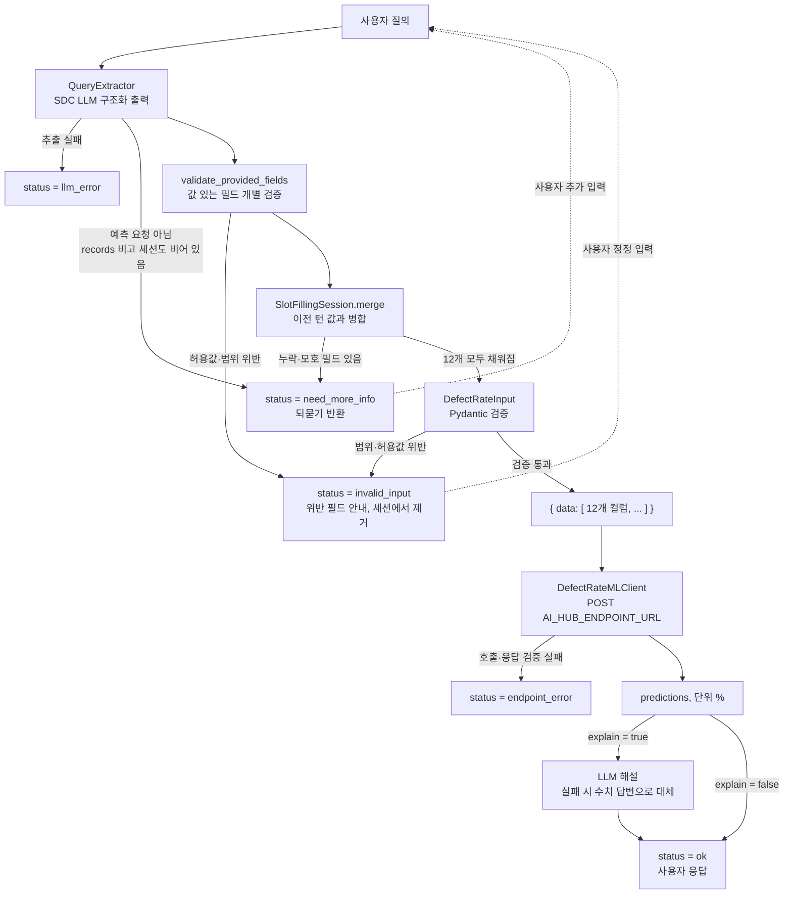

# 아키텍처 (Architecture)

사용자의 자연어 질의에서 공정 입력값을 추출해 ML API로 전달하고, 반환된 결함률 예측값을 LLM이 해설해 응답하는 파이프라인입니다.

## 1. 개요

| 항목 | 내용 |
|---|---|
| 목적 | 자연어 질의 → 결함률(%) 예측 및 해설 |
| 입력 | 사용자 질의 (한국어/영어, 자연어·키=값·구어체·JSON 붙여넣기 등) |
| 중간 산출물 | 12개 컬럼으로 구성된 JSON 레코드 (`{"data": [...]}`) |
| 출력 | `prediction(defect_rate_pct)` 예측값(단위 %) + LLM 해설(`explain=false`이면 생략) |
| 핵심 원칙 | 질의에 명시되지 않았거나 **모호한** 값은 **추측하지 않고** `null` 처리, 누락·모호 시 **API를 호출하지 않고 되묻기** |

## 2. 전체 흐름

```
사용자 질의
   │
   ▼
[QueryExtractor]  SDC LLM 구조화 출력 (json_schema → json_object → prompt 폴백)
   │  · 명시되지 않은 값 = null (추측 금지)
   │  · 모호한 값 = null + ambiguous_fields 표시
   │  · 단위/표기 정규화, 수치 반올림, 비교 질의는 다중 레코드로 분리
   │        ├─ LLM 호출·파싱 실패 → status=llm_error
   │        └─ records=[] 이고 세션도 비어 있음 → status=need_more_info (12개 전체 안내)
   ▼
[validate_provided_fields] 값이 있는 필드만 개별 검증 (슬롯이 덜 차도 실행) <!-- [추가] 2026-10-23 -->
   │        └─ 허용값·범위 위반 → status=invalid_input, 위반 필드는 세션에 저장하지 않음 (API 미호출)
   ▼
[이미 확인된 필드가 모호해졌으면 세션 슬롯 제거] <!-- [추가] 2026-10-26 로직, 2026-10-27 문서화: pipeline.py run() -->
   ▼
[SlotFillingSession.merge] 이전 턴의 확인값과 병합
   │        └─ null 필드 있음(누락·모호) → status=need_more_info + 질문 반환 (API 미호출)
   ▼
[DefectRateInput] Pydantic 검증 (타입·범위·허용값) — 12개가 모두 찬 경우에만 도달 (필드 단위 검증을 통과한 값에 대한 최종 안전망)
   │        └─ 범위·허용값 위반 → status=invalid_input, 위반 값은 세션에서 제거 (API 미호출)
   ▼
{"data": [ {12개 컬럼}, ... ]}
   │
   ▼
[DefectRateMLClient] POST $AI_HUB_ENDPOINT_URL (재시도 + 타임아웃 + 에코 검증)
   │        └─ 호출·응답 검증 실패 → status=endpoint_error
   ▼
predictions: [1.6498…, ...] (단위 %) → LLM 해설(선택) → status=ok
```



## 3. 컴포넌트 상세

### 3.1 QueryExtractor

사용자 질의에서 입력 필드를 추출하는 단계입니다. Siemens SDC LLM 게이트웨이(OpenAI 호환 `chat/completions`)를 호출합니다. <!-- [수정] 2026-10-22: 실제 구조화 출력 폴백 동작 반영 -->

- **구조화 출력 방식**: 설정 `llm_json_mode`(기본 `auto`)이면 `json_schema`(strict) → `json_object` → `prompt` 순서로 시도하고, 처음 성공한 방식을 프로세스가 살아 있는 동안 고정합니다. 서버가 스키마를 강제하는 것은 `json_schema` 모드뿐이고, 폴백 모드에서는 JSON 파싱만 하며 스키마 일치는 검증하지 않습니다. 그래서 `QueryExtractor`가 코드에서 다시 보정합니다: 빠진 키는 null, 타입 변환 실패·bool·NaN·inf는 null, 알 수 없는 `ambiguous_fields` 이름은 제거.

- **추측 금지**: 질의에 명시되지 않은 값은 `null`로 둡니다. 특히 누락된 수치를 `0` 등으로 채우는 환각을 방지해야 합니다.
- **모호한 값 처리**: 아래 유형은 값을 하나로 확정할 수 없으므로 `null`로 두고, 해당 필드를 `ambiguous_fields`에 표시합니다.

  | 유형 | 예시 | 처리 |
  |---|---|---|
  | 정성·상대 표현 | "평소보다 높다", "마모가 많이 진행됐다", "얼마 전에 정비" | `null` |
  | 범위 표현 | "습도 50에서 60% 사이", "460~470개" | `null` (평균·중간값으로 확정 금지) |
  | 단위 없는 값 | 코팅 두께 "0.08" (mm인지 µm인지 불명) | `null` |
  | 미확정 코드 | "BPR 라인 중 한 곳", "저녁 근무", "오후조", "공급사는 A나 B" | `null` |
  | 질의 내 번복 | "44.2%라고 했는데 54.2%였나" | `null` |
  | 필드를 지목한 기준 참조 | "습도는 평소와 같아요" | `null` (`ambiguous_fields`에 포함) |

  <!-- [수정] 2026-10-27 (문서 변경, 로직 변경 없음): input_schema.md 2026-10-26 정정과 동일하게, 필드를 지목하지 않은 참조는 ambiguous_fields에 들어가지 않는다는 점을 반영해 아래 항목으로 분리했다 (llm.py [불확실한 값]의 B). 이전에는 "기준 없는 참조"로 뭉뚱그려 ambiguous_fields에 포함되는 것처럼 보였다. -->
  - **필드를 지목하지 않은 기준 참조**(예: "평소랑 비슷한 조건")는 어느 필드인지 특정할 수 없어 `ambiguous_fields`에 넣지 않습니다. 프롬프트는 이 경우 해당 발화로 언급된 필드를 모두 `null`로 두고, `notes`에 "기준 조건을 알 수 없어 반영하지 않았습니다." 같은 사유를 남기도록 지시합니다. 상세 예시는 [`input_schema.md`](./input_schema.md)의 "모호한 값"을 참고합니다.
  - **세션에 이미 확인된 필드를 모호하게 다시 바꾸려는 발화** <!-- [추가] 2026-10-26 로직, 2026-10-27 문서화: pipeline.py run() 반영 -->: 예를 들어 습도 54.49%가 이미 확인된 상태에서 "습도가 꽤 높아졌다면?"처럼 되물으면, 추출 단계는 해당 필드를 `null` + `ambiguous_fields`로 내보냅니다. 파이프라인은 이를 받아 세션에 저장돼 있던 그 필드의 값을 즉시 비우므로(세션 병합 전), 기존 값으로 조용히 예측되지 않고 `missing_fields`·`ambiguous_fields`에 다시 올라 되묻습니다(다른 확인값은 유지, ML 미호출). 자세한 흐름은 [`architecture-pt2.md`](./architecture-pt2.md)의 "검증 결과별 처리"를 참고합니다. 골든 셋(v3)에는 이 경우의 단일 턴 케이스가 없어, 실제 LLM이 프롬프트대로 `ambiguous_fields`를 내는지는 회귀 테스트(대역 추출)로만 확인됩니다.

- **표기·단위 정규화**
  - 코드 정규화: 소문자 코드는 대문자로, "밤 근무"·"야간조"·"night shift"는 `NIGHT`, "주간조"·"day shift"는 `DAY`로 변환합니다. "저녁 근무"·"오후조"는 변환하지 않고 모호한 값으로 처리합니다.
  - 한글 단위 인식: "퍼센트"(%), "마이크로미터"(µm), "밀리"(mm) 등을 인식합니다.
  - 단위 환산 <!-- [수정] 2026-10-23: 코팅 두께(mm→µm)만 환산하던 규칙을 모든 필드로 확장 -->: 사용자가 필드의 기준 단위와 다른 단위로 입력해도 LLM이 기준 단위로 환산한 값을 추출합니다. 예: 코팅 0.0984mm → 98.4µm, 지그 정렬 오차 0.02cm → 0.2mm, 정비 후 2주 → 14일, 1.2천 개 → 1200. 필드별 환산표는 [`input_schema.md`](./input_schema.md)의 "단위 환산"을 참고합니다. 필드와 맞지 않는 단위(습도 5mm)나 환산 불가 단위(시간·개월)는 모호한 값으로 처리합니다. 환산했으면 `notes`에 원래 표현과 환산값을 남기도록 지시합니다.
  - 항목 표시가 없는 값 <!-- [추가] 2026-10-23; [수정] 2026-10-27 (문서 변경, 로직 변경 없음): llm.py 재확인 결과 현재 프롬프트에 번호 규칙("규칙 2-1")이 없어 실제 절 이름으로 정정 -->: 필드명 없이 값만 적힌 입력은 다음 기준으로 매칭합니다. 판단은 LLM 프롬프트(`[항목명 없는 값의 필드 결정]` 절)가 하며, 확인된 값이 있는 대화에서는 `build_extraction_user_content()`가 `[아직 필요한 값]` 목록(`known`에 없는 필드)을 추출 요청에 함께 보냅니다.
    - 문자 값: 형태로 필드가 정해지면 매칭합니다 (`LINE-…` → `production_line`, `SIM-SUP-…` → `supplier_code`, DAY/NIGHT/주간/야간 → `shift`). 허용값 밖 코드도 해당 필드로 보고 검증 단계에서 차단합니다.
    - 수치 값: `[아직 필요한 값]` 중 값의 단위와 호환되는 수치 필드가 **정확히 1개**일 때만 매칭합니다. 예: 남은 필드가 `supplier_code`와 `planned_quantity`뿐이면 "SIM-SUP-B, 480"을 각각 매칭합니다. 후보가 2개 이상이거나 ~~첫 발화(목록 없음)이면~~ 추측하지 않고 버리며 `notes`로 사유를 알립니다.
    - 예외: 단위 없는 수치는 코팅 두께의 유일한 후보여도 매칭하지 않고 모호한 값으로 처리합니다 (A03).
  - 반올림: 환산은 LLM이 하므로 `98.39999…` 같은 부동소수점 오차가 생길 수 있습니다. `QueryExtractor._coerce`가 실수 필드는 소수점 6자리로, 정수 필드(수량, 정비 경과일)는 정수로 반올림합니다. <!-- [수정] 2026-10-22: 반올림 구현 반영 (이전: 추정·확인 필요) -->
- **허용값 밖의 코드**: `LINE-BPR-03`, `SIM-SUP-D`처럼 허용값에 없는 코드는 가장 비슷한 값으로 치환하지 않고 입력된 그대로 넘겨 검증 단계에서 차단합니다. 그래서 추출 스키마의 범주형 필드는 `enum`이 아닌 자유 문자열입니다(골든 I04·I05).
- **다중 레코드 분리**: 비교 질의(예: 공구 마모도 what-if, 라인 간 비교)는 레코드 여러 개로 분리하고, 공통 조건은 각 레코드에 복제합니다. 공통으로 누락된 필드는 모든 레코드에서 `null`입니다.
- **노이즈 내성**: 날짜, 부가 맥락 등 무관한 문장이 섞여도 12개 필드만 추출합니다.
- **입력 형식**: 자연어, 키=값 나열, JSON 붙여넣기, 영문 질의를 동일하게 처리합니다.
- **records 구성 규칙**
  - 예측 의도가 있는 질의: 레코드 1개 이상. 값이 전혀 없으면 12개 필드가 모두 `null`인 레코드 1개
  - 예측 요청이 아닌 질의(범위 밖): `records = []`
  - 예측 의도 판단 기준 <!-- [추가] 2026-10-22: 골든 셋에서 암묵적이던 기준을 명시 -->
    - "결함률 예측" 같은 문구 없이 공정 조건만 나열해도 예측 의도로 봅니다 (A01~A05, A07, P08).
    - 예측에 필요한 입력을 묻는 질문도 예측 의도로 보고 전 필드 `null` 레코드를 둡니다 (N04).
    - 공정·예측과 무관한 질의만 범위 밖으로 봅니다 (N05).

### 3.2 DefectRateInput (Pydantic 검증)

추출 결과를 타입, 범위, 허용값 기준으로 검증하는 단계입니다. 필드 정의 전체는 [`input_schema.md`](./input_schema.md)를 참고합니다.

**유효값 제약 (하드 제약)**

| 필드 | 제약 |
|---|---|
| `production_line` | `LINE-BPR-01`, `LINE-BPR-02` (이 2종뿐) |
| `shift` | `DAY`, `NIGHT` |
| `supplier_code` | `SIM-SUP-A`, `SIM-SUP-B`, `SIM-SUP-C` |
| `fixture_alignment_offset_mm` | 0 이상 (0은 유효, 음수는 위반) |
| `tool_wear_pct` | 0 이상 100 이하 (0, 100은 유효) |

**현재 코드의 추가 검사 (사양 미확정)** <!-- [수정] 2026-10-22: 사양에 없지만 DefectRateInput이 차단하는 범위를 명시 -->

그 외 수치 필드는 사양상 하드 제약이 확정되지 않았습니다. 다만 현재 `DefectRateInput`은 아래 범위를 추가로 검사해, 벗어나면 `invalid_input`으로 차단합니다. 골든 셋(v3, I01~I12 포함)에는 이 검사에 걸리는 케이스가 없고 <!-- [수정] 2026-10-27 (문서 변경, 로직 변경 없음): 골든 v2 -> v3 표기 정정, data/golden_set_v3.csv의 I06~I12를 직접 대조해 확인 -->, 유지 여부는 [미결 사항](#6-미결-사항-todo)에서 관리합니다.

| 필드 | 현재 코드 검사 |
|---|---|
| `planned_quantity` | 0 이상 (정수) |
| `ambient_humidity_pct` | 0 이상 100 이하 |
| `incoming_material_quality_score` | 0 이상 100 이하 |
| `coating_target_thickness_um` | 0 이상 |
| `weld_energy_setting_pct` | 0 이상 150 이하 |
| `process_setting_deviation_pct` | 범위 검사 없음 (음수 허용) |
| `days_since_maintenance` | 0 이상 (정수) |

**검증 결과별 처리**

| 검증 결과 | 처리 | `status` | ML API 호출 |
|---|---|---|---|
| 모든 필드 유효 | 레코드를 `{"data": [...]}`로 구성 | `ok` | 호출 |
| 필드 누락 (`null`) | 누락 필드를 `missing_fields`로 수집하고 질문 생성 | `need_more_info` | **미호출** |
| 모호한 값 (`null` + `ambiguous_fields`) | 모호한 필드를 짚어 구체적인 값을 요청 | `need_more_info` | **미호출** |
| 범위·허용값 위반 | 위반 필드와 유효 범위를 알리고 재입력 요청 | `invalid_input` | **미호출** |
| 예측 요청이 아님 (세션이 비어 있을 때) | 값을 지어내지 않고 필요한 입력 안내 | `need_more_info` (`records = []`, `missing_fields` = 12개 전체, `model_input = []`, turn 그대로) | **미호출** |

- 세션에 확인값이 있을 때 `records = []`가 오면 "기존 조건 그대로"로 보고 병합 경로를 탑니다. 그래서 세션에 12개가 다 있으면 재예측, 부족하면 남은 항목을 되묻습니다. <!-- [추가] 2026-10-22: run()의 실제 분기 명시 -->
- **세션에 이미 값이 확인된 필드를 이번 발화가 모호하게 다시 바꾸려 하면** 세션 병합 전에 해당 필드의 세션 슬롯을 비웁니다. <!-- [추가] 2026-10-26 로직, 2026-10-27 문서화(이전에는 pt1·pt2 어디에도 설명이 없었음): pipeline.py run()에서 `for f in extraction.ambiguous_fields: session.slots.pop(f, None)` 확인 --> 추출 단계가 해당 필드를 `null` + `ambiguous_fields`로 반환하는 것만으로는, 이번 발화에서 언급 안 된(=`null`) 값이 병합 시 기존 세션값으로 조용히 채워져버려 모호화 의도가 묻힙니다. 그래서 `run()`이 `ambiguous_fields`에 포함된 필드는 병합 전에 세션에서 먼저 제거하여, 병합 후에도 `null`로 남아 `missing_fields`·`ambiguous_fields`에 다시 나타나게 합니다(같은 발화의 다른 확인값은 영향 없음). 판단 기준 자체는 LLM 프롬프트(`llm.py` `EXTRACTION_SYSTEM_PROMPT`의 `[대화 맥락]` 절)에 있고, 골든 셋(v3)에는 이 경우를 다루는 단일 턴 케이스가 없어 실제 LLM 응답으로는 검증되지 않았습니다(코드 동작만 보장).
- 처리 순서는 **모호해진 확인 필드의 세션 슬롯 제거 → 필드 단위 검증 → 세션 병합 → 누락 검사 → Pydantic 검증**입니다. <!-- [수정] 2026-10-23: 필드 단위 검증을 맨 앞에 추가; 2026-10-27: 2026-10-26에 추가된 모호 필드 세션 제거 단계를 순서에 반영(문서 변경, 로직 변경 없음) --> 필드 단위 검증(`validate_provided_fields`)은 값이 있는 필드만 검사하므로 슬롯이 덜 찬 상태에서도 허용값 밖 코드(`SIM-SUP-D`)나 범위 밖 값을 바로 `invalid_input`으로 막고, 위반 필드는 세션에 저장하지 않습니다(같은 발화의 유효한 값은 유지). 누락 판정은 Pydantic이 아니라 `DefectRatePipeline.run()`이 하고, 마지막 Pydantic 검증은 12개가 모두 채워진 레코드에 대한 안전망입니다.

- 추출 단계에서는 값이 정상적으로 뽑혔더라도 검증 단계에서 걸러질 수 있습니다. 예를 들어 공구 마모도 140%나 -5%는 추출에는 성공하지만 범위(0~100) 검증에서 차단됩니다.
- 모호한 값은 추출 단계에서 `null`이 되므로 검증 단계에서는 누락과 같은 경로를 타고, 되묻는 문구만 다릅니다 ("값이 없습니다"가 아니라 "'꽤 높은 편'은 수치로 알려주세요").
- 누락이 **6개 이상**이거나 같은 누락 목록을 **연속으로 다시 묻는** 경우, 되묻기 메시지에 `field=값` 형식의 **입력 템플릿**을 붙입니다(`build_question`). 템플릿의 `0`은 형식 예시일 뿐 기본값이 아닙니다. 12개가 모두 비어 있으면 "12개 값이 모두 필요" 문구와 함께 각 항목의 설명·허용값을 안내합니다. <!-- [수정] 2026-10-22: 코드 기준(6개 이상 또는 반복)으로 정정. 이전: 10개 이상 -->
- `missing_fields` 구성 규칙 <!-- [수정] 2026-10-22: N05(records=[]) 예외를 명시해 골든 셋과 일치 -->
  - 기본: 모든 레코드의 `null` 필드 합집합(중복 없음)
  - `invalid_input`: `[]`
  - 예측 요청이 아닌 질의(`records = []`): 추출된 입력이 하나도 없으므로 12개 필드 전체 (N05)
  - `ambiguous_fields`는 항상 `missing_fields`의 부분집합입니다.

### 3.3 DefectRateMLClient

검증을 통과한 JSON을 ML API로 전송하는 클라이언트입니다.

- **요청**: `POST $AI_HUB_ENDPOINT_URL`, 본문은 `{"data": [ {12개 컬럼}, ... ]}`
  - 설정 키는 `aihub/config.py`의 `ai_hub_endpoint_url`입니다. pydantic-settings는 기본적으로 환경변수 대소문자를 구분하지 않아 `AI_HUB_ENDPOINT_URL`과 같은 설정입니다 (출처: https://docs.pydantic.dev/latest/concepts/pydantic_settings/#case-sensitivity).
- **응답**: `data` 키(`ai_hub_response_key`) 아래 `prediction(defect_rate_pct)` 컬럼(`ai_hub_prediction_column`). 최상위가 배열인 응답도 받습니다. 값은 퍼센트 단위 그대로입니다(1.65 = 1.65%, 100을 곱하거나 나누지 않음).
- 레코드가 여러 개이면 요청 한 번으로 보내고, 응답의 `predictions` 순서는 요청 레코드 순서와 일치해야 합니다(별도 식별자로 재정렬하지 않음).

**안정성 (현재 구현, `aihub/ml.py`)** <!-- [수정] 2026-10-22: 재시도·에코 검증 동작 문서화 -->

| 항목 | 동작 |
|---|---|
| 타임아웃 | `ai_hub_timeout_seconds`, 기본 30초 |
| 재시도 횟수 | 최초 호출 후 추가 `ai_hub_max_retries`회, 기본 2회(총 3회 시도) |
| 재시도 대상 | HTTP 5xx, 타임아웃, 전송(연결) 오류 |
| 백오프 | 지수 백오프 `0.5 × 2^n`초. 기본 설정에서 0.5초 → 1초 |
| 즉시 실패 (재시도 없음) | HTTP 4xx, SSL 인증서 검증 실패 |
| 응답 검증 | JSON 여부, 응답 건수 = 요청 건수, 행마다 예측 컬럼 존재와 float 변환 |
| 에코 검증 | 보낸 12개 입력 컬럼이 응답 행에 있는지 확인(값 동일성은 비교하지 않음). `ai_hub_strict_echo`(기본 `true`)이면 빠진 컬럼이 있을 때 실패, `false`이면 경고 로그만 남김 |
| 실패 시 | `MLEndpointError` → 파이프라인이 `status=endpoint_error`로 변환. 답변에 오류 메시지(응답 본문 일부 포함)와 `model_input`을 담음 |
| `MOCK_ML=true` | 외부 호출 없이 레코드 순서대로 1.65, 2.65, … 반환, `latency_ms = 0` |

### 3.4 LLM 해설

예측값을 사용자 질의의 맥락에 맞춰 설명하는 단계입니다.

- 비교 질의는 레코드별 예측값을 나란히 비교해 해설합니다.
- 응답 내 수치는 ML API가 반환한 값만 사용합니다.
- `explain=false`이면 호출하지 않고 `예측 결함률: 1.65%` 형식의 수치 답변만 반환합니다. 해설 호출이 실패해도 같은 수치 답변로 대체하고 `status=ok`를 유지합니다.

### 3.5 구현 매핑 (2026-10-27 기준) <!-- [수정] 2026-10-27 (문서 변경, 로직 변경 없음): 날짜가 2026-10-22로 고정돼 있었으나 표 내용은 이미 2026-10-23·26 변경을 담고 있어 실제 기준일로 정정 -->

<!-- [수정] 2026-10-22: 컴포넌트 전체에 걸치는 내용이라 기존 3.3.1에서 별도 절로 이동 -->

| 규칙 | 구현 위치 |
|---|---|
| 모호값 유형(A: 필드 특정, B: 필드 미특정), 허용값 밖 값 보존, 한글 단위, 예측 의도 판단 | `llm.py` `EXTRACTION_SYSTEM_PROMPT`의 `[불확실한 값: A / B 두 가지로만 처리한다]` 등 절 (LLM 지침이므로 준수 여부는 실제 호출로 평가 필요) <!-- [수정] 2026-10-27 (문서 변경, 로직 변경 없음): llm.py 재확인 결과 "6유형" 나열이 아니라 A/B 두 갈래 구조였음 -->|
| 구조화 출력 폴백(json_schema → json_object → prompt) | `llm.py` `SDCLLMClient.chat_json()` |
| `ambiguous_fields` 출력 | `schema.py` `extraction_json_schema()` (필드명 enum) |
| 모호 필드 값 null 강제, 알 수 없는 필드명 제거 | `pipeline.py` `QueryExtractor.extract()` |
| 실수 6자리·정수 반올림, bool·NaN·inf → null | `pipeline.py` `QueryExtractor._coerce()` |
| 세션 병합, 레코드 간 공통값만 슬롯에 저장 | `pipeline.py` `SlotFillingSession.merge()` |
| N05: `records=[]`이고 세션이 비었으면 `missing_fields` 12개, `model_input=[]`, turn 그대로 | `pipeline.py` `DefectRatePipeline.run()` |
| 누락 검사(병합 후, Pydantic 전) | `pipeline.py` `run()` |
| `ambiguous_fields ⊆ missing_fields`, 모호 항목 전용 되묻기 문구, 입력 템플릿 | `pipeline.py` `run()`, `build_question()` |
| 위반 필드 목록(`invalid_fields`), 허용 범위 안내, 위반 값 세션 제거 | `pipeline.py` `_invalid_result()` (2026-10-23: `run()` 안의 처리를 함수로 분리) |
| 슬롯이 덜 찬 상태의 필드 단위 검증 (기준 행에 값을 덮어 `DefectRateInput` 규칙 재사용) | `schema.py` `validate_provided_fields()`, `pipeline.py` `run()` |
| 항목 표시 없는 값 매칭, 모든 필드의 단위 환산 지시 (LLM 지침이므로 준수 여부는 실제 호출로 평가 필요) | `llm.py` `EXTRACTION_SYSTEM_PROMPT`의 `[항목명 없는 값의 필드 결정]`·`[정규화]` 절 <!-- [수정] 2026-10-27 (문서 변경, 로직 변경 없음): "규칙 2-1·4·5·15" 번호 체계가 현재 프롬프트에 없어 실제 절 이름으로 정정 -->|
| `[아직 필요한 값]` 목록 전달 (`known`에 없는 필드) | `llm.py` `build_extraction_user_content()` |
| 이미 확인된 필드를 모호하게 정정하면 세션 슬롯 제거 후 재질문 | `pipeline.py` `DefectRatePipeline.run()` <!-- [추가] 2026-10-27 (문서 변경, 로직 변경 없음): 2026-10-26에 추가된 로직을 매핑표에 반영 -->|
| 값을 버린 사유·환산 내역(`notes`)을 되묻기 앞에 표시 | `pipeline.py` `build_question(notes=…)` |
| 하드 제약 + 추가 범위 검사 | `schema.py` `DefectRateInput` |
| 재시도·응답 검증·에코 검증 | `ml.py` `DefectRateMLClient._post()`, `parse()` |
| 세션 저장 | `api.py` `_sessions` (프로세스 메모리 dict) |

대화 응답에 `ambiguous_fields`, `invalid_fields`가 추가됐습니다. 누락과 위반이 함께 있으면 필드 단위 검증이 먼저라 `invalid_input`이 반환됩니다. <!-- [수정] 2026-10-23: 이전에는 누락 검사가 먼저라 need_more_info가 반환됨 -->

## 4. 응답 상태 (`status`)

| 값 | 의미 | ML API 호출 | 후속 동작 |
|---|---|---|---|
| `ok` | 모든 입력이 유효하고 예측 완료 | O | 예측값과 해설 반환 |
| `need_more_info` | 입력이 누락·모호하거나 예측 요청이 아님 | X | 누락·모호 항목 질문 반환 |
| `invalid_input` | 값이 범위·허용값 검증에 실패 | X | 위반 필드(`invalid_fields`) 안내 후 정정 요청 |
| `llm_error` | 자연어 추출(LLM 호출 또는 JSON 파싱) 실패 | X | 오류 안내. 세션은 바뀌지 않음(turn 그대로) |
| `endpoint_error` | ML API 호출 또는 응답 검증 실패 | O (시도 후 실패) | 오류 안내, `model_input` 반환 |

<!-- [수정] 2026-10-22: 코드의 Status 5종에 맞춰 llm_error·endpoint_error 추가 -->

- HTTP API에서는 위 5개 상태가 모두 HTTP 200으로 전달됩니다. 빈 질의는 HTTP 422, 필수 설정 누락 등으로 파이프라인을 초기화하지 못하면 HTTP 503입니다(`api.py`).
- 해설 생성만 실패한 경우는 오류 상태가 아니라 `ok`입니다(§3.4).

## 5. 멀티턴 처리

`need_more_info` 또는 `invalid_input` 이후 사용자가 값을 보충·정정하면, 이전 턴의 값과 합쳐 다시 검증합니다. 이전 턴의 추출 결과(레코드)는 세션 상태로 유지해야 합니다. 골든 셋(`data/golden_set_v3_multi_turn.csv`)의 멀티턴 시나리오는 다음 14가지입니다. <!-- [수정] 2026-10-27 (문서 변경, 로직 변경 없음): 골든 셋이 v2(6개, MT01~06)에서 v3(14개, MT01~14)로 확장된 뒤 pt2가 갱신되지 않아 CSV를 직접 읽고 반영 --> MT07~14는 2026-10-23에 추가된 필드 단위 검증, 항목 표시 없는 값 매칭, 모든 필드 단위 환산 규칙을 멀티턴으로 검증합니다.

| ID | 입력 패턴 | 시나리오 | 기대 동작 |
|---|---|---|---|
| MT01 | partial → partial → complete | 슬롯 채우기 | 3개 누락 → 2개 보충 후 1개 남음 → 마지막 값 입력 후 `ok` |
| MT02 | none → partial → complete | 값 없이 시작 | 12개 모두 되묻기 → 7개 제공 후 5개 남음 → 나머지 입력 후 `ok` |
| MT03 | ambiguous → complete | 모호한 표현 확정 | "습도는 꽤 높은 편" → 되묻기 → "61.5%" 입력 후 `ok` |
| MT04 | invalid → complete | 위반 값 정정 | 마모율 140% → `invalid_input` → "40%입니다" 정정 후 `ok` |
| MT05 | complete → complete | what-if 후속 질의 | "공구 마모가 70%까지 올라가면?"처럼 **특정 필드만 변경**, 나머지는 이전 값 유지 |
| MT06 | complete → complete | 정정 | "야간조가 아니라 주간조입니다"처럼 앞 턴의 값을 **정정**하고 재예측 |
| MT07 | partial(invalid) → partial → complete | 슬롯 채우는 중 위반 코드 등장 | `SIM-SUP-D` → `invalid_input`(다른 값은 세션 유지) → `SIM-SUP-B`로 정정 후 `need_more_info`(8개 남음) → 나머지 입력 후 `ok` |
| MT08 | partial(invalid) → partial → complete | 누락과 위반 동시 발생 시 위반 우선 | 공구 마모 140%(+정비일 누락) → `invalid_input`(위반 우선 처리, `tool_wear_pct` 세션 제거) → 정비일만 입력해도 `tool_wear_pct` 누락으로 `need_more_info` → 올바른 값 입력 후 `ok` |
| MT09 | partial → complete | 항목 표시 없는 값 2개 동시 매칭 | 누락이 `supplier_code`·`planned_quantity` 둘뿐일 때 "SIM-SUP-B, 480" → 형태(코드 패턴)·후보 1개(수치)로 각각 매칭돼 바로 `ok` |
| MT10 | partial → partial → complete | 단위로 필드가 특정되는 항목 표시 없는 수치 | "480개"는 단위 "개"로 `planned_quantity`에 매칭 → 남은 `tool_wear_pct`·`days_since_maintenance` 입력 후 `ok` |
| MT11 | partial → partial → complete | 후보 2개 이상인 항목 표시 없는 값은 버림 | "35%"는 `ambient_humidity_pct`·`tool_wear_pct` 둘 다 호환돼 버려지고(`ambiguous_fields`가 아닌 미언급으로 처리, `notes`로 사유 안내) `need_more_info` 유지 → 필드명을 명시해 입력 후 `ok` |
| MT12 | partial → ambiguous → complete | 단위 없는 코팅 두께는 유일 후보여도 모호 처리(예외) | "66"은 남은 필드가 `coating_target_thickness_um` 하나뿐이어도 단위가 없어 `ambiguous_fields`로 되묻기 → "66마이크로미터요" 입력 후 `ok` |
| MT13 | partial → complete | 단위 없는 수치라도 유일 후보면 매칭(코팅 두께 제외) | 남은 필드가 `days_since_maintenance` 하나뿐이면 단위 없는 "20"도 매칭되어 바로 `ok` |
| MT14 | complete → complete | what-if 질의의 단위 환산 | "지그 정렬 오차가 0.05cm라면?" → `fixture_alignment_offset_mm=0.5`로 환산해 해당 필드만 변경, 나머지는 이전 값 유지 후 `ok` |

## 변경 이력

- 2026-10-22 (문서 변경, 로직 변경 없음): 코드 대조 검토 결과 반영. §2 흐름도를 실제 순서(추출 → 세션 병합 → 누락 검사 → Pydantic → ML)로 고침. 상태 5종(`llm_error`·`endpoint_error` 추가). 예측값 예시를 퍼센트 단위로 정정. 구조화 출력 폴백, 코드의 추가 범위 검사, 템플릿 조건(6개 이상 또는 반복), N05의 세션 조건, 재시도·백오프·에코 검증, 해설 생략·실패 대체를 문서화. 구현 매핑을 3.3.1에서 3.5로 옮김. 미결 사항에 현재 동작을 덧붙이고 중복 항목(수치 범위)을 합침.
- 2026-10-22 (로직 변경): `ambiguous_fields` 추출·응답, 추출 프롬프트 규칙 보강, N05 처리, 수치 반올림, `invalid_fields` 추가. test_core를 v2로 전환하고 `test/test_golden_v2.py` 추가. 상세는 3.5.
- 2026-10-22 (문서 변경, 로직 변경 없음): 골든 셋 경로를 `data/golden_set_v2.json`으로 수정. `missing_fields`의 N05 규칙(12개 전체), 예측 의도 판단 기준, "오후조" 모호 예시, 환산 시 부동소수점 주의, 환경변수 대소문자 설명을 추가. 회귀 기준 턴 표기를 MT01 3턴·MT05 1턴·MT06 2턴으로 정정. 재시도·타임아웃 코드 기본값, test_core 경로 불일치, 멀티턴 모호 필드, 반올림 자릿수를 미결 사항에 추가.
- 2026-10-23 (로직 변경): 필드 단위 검증(`validate_provided_fields`)을 세션 병합 앞에 추가해 슬롯이 덜 찬 상태에서도 허용값 밖 코드·범위 밖 값을 차단. 항목 표시 없는 값 매칭(문자: 형태 기준, 수치: `[아직 필요한 값]` 중 호환 후보가 1개일 때만), 모든 필드의 단위 환산(지그 오차 cm → mm 등), 되묻기 문구에 `notes` 표시를 추가. 누락·위반 동시 발생 시 위반 우선으로 변경. 흐름도·§3.1·§3.2·§3.5·§6 갱신.
- 2026-10-27 (문서 변경, 로직 변경 없음): pt1·pt2를 `llm.py`·`pipeline.py`·`schema.py` 코드와 골든 셋(v3)에 재대조. (1) §2 흐름도·§3.1·"검증 결과별 처리"·§3.5에, 2026-10-26에 추가됐으나 문서화되지 않았던 "이미 확인된 필드를 모호하게 정정하면 세션 병합 전에 해당 슬롯을 비운다"(`pipeline.py` `run()`)는 로직을 반영. (2) §3.1 모호한 값 표의 "기준 없는 참조" 행이 실제로는 `ambiguous_fields`에 들어가지 않는(B 유형) 사례였던 오류를 바로잡아 "필드를 지목한/지목하지 않은 기준 참조"로 분리(`input_schema.md`의 2026-10-26 정정과 동일 기준). (3) 더 이상 존재하지 않는 "규칙 2-1·4·5·15" 번호 참조를 `llm.py`의 실제 절 이름(`[항목명 없는 값의 필드 결정]` 등)으로 정정. (4) §5 멀티턴 표를 골든 v2 기준 6개(MT01~06)에서 v3 기준 14개(MT01~14, `data/golden_set_v3_multi_turn.csv` 직접 대조)로 갱신. (5) pt1 §3.2의 "골든 v2" 표기를 v3(I01~I12 포함)로 정정.