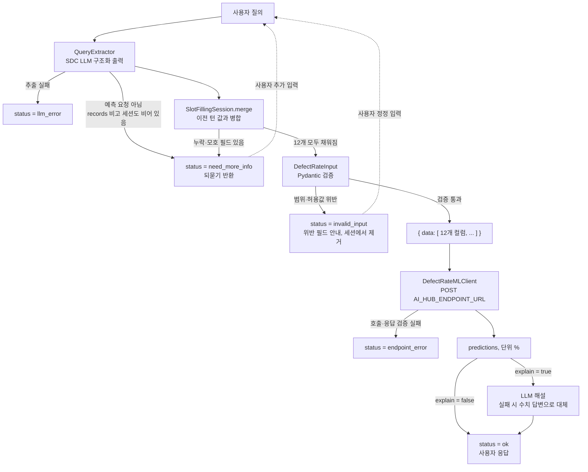

# 아키텍처 (Architecture)

사용자의 자연어 질의에서 공정 입력값을 추출해 ML API로 전달하고, 반환된 결함률 예측값을 LLM이 해설해 응답하는 파이프라인입니다.

## 1. 개요

| 항목 | 내용 |
|---|---|
| 목적 | 자연어 질의 → 결함률(%) 예측 및 해설 |
| 입력 | 사용자 질의 (한국어/영어, 자연어·키=값·구어체·JSON 붙여넣기 등) |
| 중간 산출물 | 12개 컬럼으로 구성된 JSON 레코드 (`{"data": [...]}`) |
| 출력 | `prediction(defect_rate_pct)` 예측값(단위 %) + LLM 해설(`explain=false`이면 생략) |
| 핵심 원칙 | 질의에 명시되지 않았거나 **모호한** 값은 **추측하지 않고** `null` 처리, 누락·모호 시 **API를 호출하지 않고 되묻기** |

## 2. 전체 흐름

```
사용자 질의
   │
   ▼
[QueryExtractor]  SDC LLM 구조화 출력 (json_schema → json_object → prompt 폴백)
   │  · 명시되지 않은 값 = null (추측 금지)
   │  · 모호한 값 = null + ambiguous_fields 표시
   │  · 단위/표기 정규화, 수치 반올림, 비교 질의는 다중 레코드로 분리
   │        ├─ LLM 호출·파싱 실패 → status=llm_error
   │        └─ records=[] 이고 세션도 비어 있음 → status=need_more_info (12개 전체 안내)
   ▼
[SlotFillingSession.merge] 이전 턴의 확인값과 병합
   │        └─ null 필드 있음(누락·모호) → status=need_more_info + 질문 반환 (API 미호출)
   ▼
[DefectRateInput] Pydantic 검증 (타입·범위·허용값) — 12개가 모두 찬 경우에만 도달
   │        └─ 범위·허용값 위반 → status=invalid_input, 위반 값은 세션에서 제거 (API 미호출)
   ▼
{"data": [ {12개 컬럼}, ... ]}
   │
   ▼
[DefectRateMLClient] POST $AI_HUB_ENDPOINT_URL (재시도 + 타임아웃 + 에코 검증)
   │        └─ 호출·응답 검증 실패 → status=endpoint_error
   ▼
predictions: [1.6498…, ...] (단위 %) → LLM 해설(선택) → status=ok
```



## 3. 컴포넌트 상세

### 3.1 QueryExtractor

사용자 질의에서 입력 필드를 추출하는 단계입니다. Siemens SDC LLM 게이트웨이(OpenAI 호환 `chat/completions`)를 호출합니다. <!-- [수정] 2026-10-22: 실제 구조화 출력 폴백 동작 반영 -->

- **구조화 출력 방식**: 설정 `llm_json_mode`(기본 `auto`)이면 `json_schema`(strict) → `json_object` → `prompt` 순서로 시도하고, 처음 성공한 방식을 프로세스가 살아 있는 동안 고정합니다. 서버가 스키마를 강제하는 것은 `json_schema` 모드뿐이고, 폴백 모드에서는 JSON 파싱만 하며 스키마 일치는 검증하지 않습니다. 그래서 `QueryExtractor`가 코드에서 다시 보정합니다: 빠진 키는 null, 타입 변환 실패·bool·NaN·inf는 null, 알 수 없는 `ambiguous_fields` 이름은 제거.

- **추측 금지**: 질의에 명시되지 않은 값은 `null`로 둡니다. 특히 누락된 수치를 `0` 등으로 채우는 환각을 방지해야 합니다.
- **모호한 값 처리**: 아래 유형은 값을 하나로 확정할 수 없으므로 `null`로 두고, 해당 필드를 `ambiguous_fields`에 표시합니다.

  | 유형 | 예시 | 처리 |
  |---|---|---|
  | 정성·상대 표현 | "평소보다 높다", "마모가 많이 진행됐다", "얼마 전에 정비" | `null` |
  | 범위 표현 | "습도 50에서 60% 사이", "460~470개" | `null` (평균·중간값으로 확정 금지) |
  | 단위 없는 값 | 코팅 두께 "0.08" (mm인지 µm인지 불명) | `null` |
  | 미확정 코드 | "BPR 라인 중 한 곳", "저녁 근무", "오후조", "공급사는 A나 B" | `null` |
  | 질의 내 번복 | "44.2%라고 했는데 54.2%였나" | `null` |
  | 기준 없는 참조 | "평소랑 비슷한 조건" | 해당 값 `null` |

- **표기·단위 정규화**
  - 코드 정규화: 소문자 코드는 대문자로, "밤 근무"·"야간조"·"night shift"는 `NIGHT`, "주간조"·"day shift"는 `DAY`로 변환합니다. "저녁 근무"·"오후조"는 변환하지 않고 모호한 값으로 처리합니다.
  - 한글 단위 인식: "퍼센트"(%), "마이크로미터"(µm), "밀리"(mm) 등을 인식합니다.
  - 단위 환산: 코팅 두께가 mm로 들어오면 µm으로 환산(×1000)합니다 (예: 0.0984mm → 98.4). 지그 정렬 오차는 mm 그대로 유지합니다.
  - 반올림: 환산은 LLM이 하므로 `98.39999…` 같은 부동소수점 오차가 생길 수 있습니다. `QueryExtractor._coerce`가 실수 필드는 소수점 6자리로, 정수 필드(수량, 정비 경과일)는 정수로 반올림합니다. <!-- [수정] 2026-10-22: 반올림 구현 반영 (이전: 추정·확인 필요) -->
- **허용값 밖의 코드**: `LINE-BPR-03`, `SIM-SUP-D`처럼 허용값에 없는 코드는 가장 비슷한 값으로 치환하지 않고 입력된 그대로 넘겨 검증 단계에서 차단합니다. 그래서 추출 스키마의 범주형 필드는 `enum`이 아닌 자유 문자열입니다(골든 I04·I05).
- **다중 레코드 분리**: 비교 질의(예: 공구 마모도 what-if, 라인 간 비교)는 레코드 여러 개로 분리하고, 공통 조건은 각 레코드에 복제합니다. 공통으로 누락된 필드는 모든 레코드에서 `null`입니다.
- **노이즈 내성**: 날짜, 부가 맥락 등 무관한 문장이 섞여도 12개 필드만 추출합니다.
- **입력 형식**: 자연어, 키=값 나열, JSON 붙여넣기, 영문 질의를 동일하게 처리합니다.
- **records 구성 규칙**
  - 예측 의도가 있는 질의: 레코드 1개 이상. 값이 전혀 없으면 12개 필드가 모두 `null`인 레코드 1개
  - 예측 요청이 아닌 질의(범위 밖): `records = []`
  - 예측 의도 판단 기준 <!-- [추가] 2026-10-22: 골든 셋에서 암묵적이던 기준을 명시 -->
    - "결함률 예측" 같은 문구 없이 공정 조건만 나열해도 예측 의도로 봅니다 (A01~A05, A07, P08).
    - 예측에 필요한 입력을 묻는 질문도 예측 의도로 보고 전 필드 `null` 레코드를 둡니다 (N04).
    - 공정·예측과 무관한 질의만 범위 밖으로 봅니다 (N05).

### 3.2 DefectRateInput (Pydantic 검증)

추출 결과를 타입, 범위, 허용값 기준으로 검증하는 단계입니다. 필드 정의 전체는 [`input_schema.md`](./input_schema.md)를 참고합니다.

**유효값 제약 (하드 제약)**

| 필드 | 제약 |
|---|---|
| `production_line` | `LINE-BPR-01`, `LINE-BPR-02` (이 2종뿐) |
| `shift` | `DAY`, `NIGHT` |
| `supplier_code` | `SIM-SUP-A`, `SIM-SUP-B`, `SIM-SUP-C` |
| `fixture_alignment_offset_mm` | 0 이상 (0은 유효, 음수는 위반) |
| `tool_wear_pct` | 0 이상 100 이하 (0, 100은 유효) |

**현재 코드의 추가 검사 (사양 미확정)** <!-- [수정] 2026-10-22: 사양에 없지만 DefectRateInput이 차단하는 범위를 명시 -->

그 외 수치 필드는 사양상 하드 제약이 확정되지 않았습니다. 다만 현재 `DefectRateInput`은 아래 범위를 추가로 검사해, 벗어나면 `invalid_input`으로 차단합니다. 골든 v2에는 이 검사에 걸리는 케이스가 없고, 유지 여부는 [미결 사항](#6-미결-사항-todo)에서 관리합니다.

| 필드 | 현재 코드 검사 |
|---|---|
| `planned_quantity` | 0 이상 (정수) |
| `ambient_humidity_pct` | 0 이상 100 이하 |
| `incoming_material_quality_score` | 0 이상 100 이하 |
| `coating_target_thickness_um` | 0 이상 |
| `weld_energy_setting_pct` | 0 이상 150 이하 |
| `process_setting_deviation_pct` | 범위 검사 없음 (음수 허용) |
| `days_since_maintenance` | 0 이상 (정수) |

**검증 결과별 처리**

| 검증 결과 | 처리 | `status` | ML API 호출 |
|---|---|---|---|
| 모든 필드 유효 | 레코드를 `{"data": [...]}`로 구성 | `ok` | 호출 |
| 필드 누락 (`null`) | 누락 필드를 `missing_fields`로 수집하고 질문 생성 | `need_more_info` | **미호출** |
| 모호한 값 (`null` + `ambiguous_fields`) | 모호한 필드를 짚어 구체적인 값을 요청 | `need_more_info` | **미호출** |
| 범위·허용값 위반 | 위반 필드와 유효 범위를 알리고 재입력 요청 | `invalid_input` | **미호출** |
| 예측 요청이 아님 (세션이 비어 있을 때) | 값을 지어내지 않고 필요한 입력 안내 | `need_more_info` (`records = []`, `missing_fields` = 12개 전체, `model_input = []`, turn 그대로) | **미호출** |

- 세션에 확인값이 있을 때 `records = []`가 오면 "기존 조건 그대로"로 보고 병합 경로를 탑니다. 그래서 세션에 12개가 다 있으면 재예측, 부족하면 남은 항목을 되묻습니다. <!-- [추가] 2026-10-22: run()의 실제 분기 명시 -->
- 처리 순서는 **세션 병합 → 누락 검사 → Pydantic 검증**입니다. 누락 판정은 Pydantic이 아니라 `DefectRatePipeline.run()`이 하고, Pydantic은 12개가 모두 채워진 레코드만 검증합니다.

- 추출 단계에서는 값이 정상적으로 뽑혔더라도 검증 단계에서 걸러질 수 있습니다. 예를 들어 공구 마모도 140%나 -5%는 추출에는 성공하지만 범위(0~100) 검증에서 차단됩니다.
- 모호한 값은 추출 단계에서 `null`이 되므로 검증 단계에서는 누락과 같은 경로를 타고, 되묻는 문구만 다릅니다 ("값이 없습니다"가 아니라 "'꽤 높은 편'은 수치로 알려주세요").
- 누락이 **6개 이상**이거나 같은 누락 목록을 **연속으로 다시 묻는** 경우, 되묻기 메시지에 `field=값` 형식의 **입력 템플릿**을 붙입니다(`build_question`). 템플릿의 `0`은 형식 예시일 뿐 기본값이 아닙니다. 12개가 모두 비어 있으면 "12개 값이 모두 필요" 문구와 함께 각 항목의 설명·허용값을 안내합니다. <!-- [수정] 2026-10-22: 코드 기준(6개 이상 또는 반복)으로 정정. 이전: 10개 이상 -->
- `missing_fields` 구성 규칙 <!-- [수정] 2026-10-22: N05(records=[]) 예외를 명시해 골든 셋과 일치 -->
  - 기본: 모든 레코드의 `null` 필드 합집합(중복 없음)
  - `invalid_input`: `[]`
  - 예측 요청이 아닌 질의(`records = []`): 추출된 입력이 하나도 없으므로 12개 필드 전체 (N05)
  - `ambiguous_fields`는 항상 `missing_fields`의 부분집합입니다.

### 3.3 DefectRateMLClient

검증을 통과한 JSON을 ML API로 전송하는 클라이언트입니다.

- **요청**: `POST $AI_HUB_ENDPOINT_URL`, 본문은 `{"data": [ {12개 컬럼}, ... ]}`
  - 설정 키는 `aihub/config.py`의 `ai_hub_endpoint_url`입니다. pydantic-settings는 기본적으로 환경변수 대소문자를 구분하지 않아 `AI_HUB_ENDPOINT_URL`과 같은 설정입니다 (출처: https://docs.pydantic.dev/latest/concepts/pydantic_settings/#case-sensitivity).
- **응답**: `data` 키(`ai_hub_response_key`) 아래 `prediction(defect_rate_pct)` 컬럼(`ai_hub_prediction_column`). 최상위가 배열인 응답도 받습니다. 값은 퍼센트 단위 그대로입니다(1.65 = 1.65%, 100을 곱하거나 나누지 않음).
- 레코드가 여러 개이면 요청 한 번으로 보내고, 응답의 `predictions` 순서는 요청 레코드 순서와 일치해야 합니다(별도 식별자로 재정렬하지 않음).

**안정성 (현재 구현, `aihub/ml.py`)** <!-- [수정] 2026-10-22: 재시도·에코 검증 동작 문서화 -->

| 항목 | 동작 |
|---|---|
| 타임아웃 | `ai_hub_timeout_seconds`, 기본 30초 |
| 재시도 횟수 | 최초 호출 후 추가 `ai_hub_max_retries`회, 기본 2회(총 3회 시도) |
| 재시도 대상 | HTTP 5xx, 타임아웃, 전송(연결) 오류 |
| 백오프 | 지수 백오프 `0.5 × 2^n`초. 기본 설정에서 0.5초 → 1초 |
| 즉시 실패 (재시도 없음) | HTTP 4xx, SSL 인증서 검증 실패 |
| 응답 검증 | JSON 여부, 응답 건수 = 요청 건수, 행마다 예측 컬럼 존재와 float 변환 |
| 에코 검증 | 보낸 12개 입력 컬럼이 응답 행에 있는지 확인(값 동일성은 비교하지 않음). `ai_hub_strict_echo`(기본 `true`)이면 빠진 컬럼이 있을 때 실패, `false`이면 경고 로그만 남김 |
| 실패 시 | `MLEndpointError` → 파이프라인이 `status=endpoint_error`로 변환. 답변에 오류 메시지(응답 본문 일부 포함)와 `model_input`을 담음 |
| `MOCK_ML=true` | 외부 호출 없이 레코드 순서대로 1.65, 2.65, … 반환, `latency_ms = 0` |

### 3.4 LLM 해설

예측값을 사용자 질의의 맥락에 맞춰 설명하는 단계입니다.

- 비교 질의는 레코드별 예측값을 나란히 비교해 해설합니다.
- 응답 내 수치는 ML API가 반환한 값만 사용합니다.
- `explain=false`이면 호출하지 않고 `예측 결함률: 1.65%` 형식의 수치 답변만 반환합니다. 해설 호출이 실패해도 같은 수치 답변로 대체하고 `status=ok`를 유지합니다.

### 3.5 구현 매핑 (2026-10-22 기준)

<!-- [수정] 2026-10-22: 컴포넌트 전체에 걸치는 내용이라 기존 3.3.1에서 별도 절로 이동 -->

| 규칙 | 구현 위치 |
|---|---|
| 모호값 6유형, 허용값 밖 값 보존, 한글 단위, 예측 의도 판단 | `llm.py` `EXTRACTION_SYSTEM_PROMPT` (LLM 지침이므로 준수 여부는 실제 호출로 평가 필요) |
| 구조화 출력 폴백(json_schema → json_object → prompt) | `llm.py` `SDCLLMClient.chat_json()` |
| `ambiguous_fields` 출력 | `schema.py` `extraction_json_schema()` (필드명 enum) |
| 모호 필드 값 null 강제, 알 수 없는 필드명 제거 | `pipeline.py` `QueryExtractor.extract()` |
| 실수 6자리·정수 반올림, bool·NaN·inf → null | `pipeline.py` `QueryExtractor._coerce()` |
| 세션 병합, 레코드 간 공통값만 슬롯에 저장 | `pipeline.py` `SlotFillingSession.merge()` |
| N05: `records=[]`이고 세션이 비었으면 `missing_fields` 12개, `model_input=[]`, turn 그대로 | `pipeline.py` `DefectRatePipeline.run()` |
| 누락 검사(병합 후, Pydantic 전) | `pipeline.py` `run()` |
| `ambiguous_fields ⊆ missing_fields`, 모호 항목 전용 되묻기 문구, 입력 템플릿 | `pipeline.py` `run()`, `build_question()` |
| 위반 필드 목록(`invalid_fields`), 허용 범위 안내, 위반 값 세션 제거 | `pipeline.py` `run()` |
| 하드 제약 + 추가 범위 검사 | `schema.py` `DefectRateInput` |
| 재시도·응답 검증·에코 검증 | `ml.py` `DefectRateMLClient._post()`, `parse()` |
| 세션 저장 | `api.py` `_sessions` (프로세스 메모리 dict) |

대화 응답에 `ambiguous_fields`, `invalid_fields`가 추가됐습니다. 누락과 위반이 함께 있으면 현재는 누락 검사가 먼저라 `need_more_info`가 반환됩니다(우선순위는 미결).

## 4. 응답 상태 (`status`)

| 값 | 의미 | ML API 호출 | 후속 동작 |
|---|---|---|---|
| `ok` | 모든 입력이 유효하고 예측 완료 | O | 예측값과 해설 반환 |
| `need_more_info` | 입력이 누락·모호하거나 예측 요청이 아님 | X | 누락·모호 항목 질문 반환 |
| `invalid_input` | 값이 범위·허용값 검증에 실패 | X | 위반 필드(`invalid_fields`) 안내 후 정정 요청 |
| `llm_error` | 자연어 추출(LLM 호출 또는 JSON 파싱) 실패 | X | 오류 안내. 세션은 바뀌지 않음(turn 그대로) |
| `endpoint_error` | ML API 호출 또는 응답 검증 실패 | O (시도 후 실패) | 오류 안내, `model_input` 반환 |

<!-- [수정] 2026-10-22: 코드의 Status 5종에 맞춰 llm_error·endpoint_error 추가 -->

- HTTP API에서는 위 5개 상태가 모두 HTTP 200으로 전달됩니다. 빈 질의는 HTTP 422, 필수 설정 누락 등으로 파이프라인을 초기화하지 못하면 HTTP 503입니다(`api.py`).
- 해설 생성만 실패한 경우는 오류 상태가 아니라 `ok`입니다(§3.4).

## 5. 멀티턴 처리

`need_more_info` 또는 `invalid_input` 이후 사용자가 값을 보충·정정하면, 이전 턴의 값과 합쳐 다시 검증합니다. 이전 턴의 추출 결과(레코드)는 세션 상태로 유지해야 합니다. 골든 셋의 멀티턴 시나리오는 다음 6가지입니다.

| ID | 입력 패턴 | 시나리오 | 기대 동작 |
|---|---|---|---|
| MT01 | partial → partial → complete | 슬롯 채우기 | 3개 누락 → 2개 보충 후 1개 남음 → 마지막 값 입력 후 `ok` |
| MT02 | none → partial → complete | 값 없이 시작 | 12개 모두 되묻기 → 7개 제공 후 5개 남음 → 나머지 입력 후 `ok` |
| MT03 | ambiguous → complete | 모호한 표현 확정 | "습도는 꽤 높은 편" → 되묻기 → "61.5%" 입력 후 `ok` |
| MT04 | invalid → complete | 위반 값 정정 | 마모율 140% → `invalid_input` → "40%입니다" 정정 후 `ok` |
| MT05 | complete → complete | what-if 후속 질의 | "공구 마모가 70%까지 올라가면?"처럼 **특정 필드만 변경**, 나머지는 이전 값 유지 |
| MT06 | complete → complete | 정정 | "야간조가 아니라 주간조입니다"처럼 앞 턴의 값을 **정정**하고 재예측 |

## 6. 미결 사항 (TODO)

정책으로 확정되지 않은 항목입니다. 코드에 이미 동작이 있는 항목은 "현재 동작"을 함께 적었습니다. <!-- [수정] 2026-10-22: 코드로 답이 있는 항목에 현재 동작 병기, 중복 항목 통합 -->

- [ ] 사용 모델명 — 현재: `.env`의 `LLM_MODEL`로 지정(코드 기본값 없음). 운영 모델 확정 필요. 구조화 출력은 §3.1의 폴백 방식이며 스키마 버전 관리는 없음
- [ ] ML API 재시도·타임아웃 운영 값 — 현재: 타임아웃 30초, 추가 재시도 2회, 지수 백오프 `0.5 × 2^n`초, 4xx·SSL 오류는 재시도 없음(§3.3). 이 값을 운영 기준으로 확정할지
- [ ] ML API 오류 시 사용자 응답 정책 — 현재: `endpoint_error`로 반환하고 답변에 오류 메시지(4xx는 응답 본문 최대 500자, 5xx는 300자)를 포함. 외부 서비스의 오류 원문을 사용자에게 그대로 보여줄지 결정 필요
- [ ] 세션 저장 위치와 만료 정책 — 현재: `api.py`의 프로세스 메모리 dict. 만료·영속 저장·워커 간 공유가 없고 서버 재시작 시 사라짐
- [ ] 사양에 하드 제약이 없는 수치 필드의 허용 범위 — 현재: 코드가 §3.2 "현재 코드의 추가 검사" 범위를 `invalid_input`으로 차단(골든 v2에 해당 케이스 없음). 사양으로 확정할지, 코드에서 뺄지 결정 필요
- [ ] 한 번에 허용하는 최대 레코드 수 — 현재: 제한 없음
- [x] 예측값 표기 단위 → 퍼센트(1.65 = 1.65%). 근거: C01 실측값 `1.6498678908`, `ml.py`의 `unit: "percent"`. 예전 §2의 `0.0312` 예시는 잘못된 표기여서 수정함
- [x] 범주형 필드의 스키마 정의 → JSON Schema `enum`을 쓰지 않고 자유 문자열로 추출한 뒤 Pydantic에서 차단. `enum`을 쓰면 `LINE-BPR-03`이 `invalid_input` 대신 null(되묻기)이 되어 골든 I04·I05 기대값과 달라지기 때문
- [ ] **누락과 위반이 함께 있을 때의 우선순위** — 현재: 누락 우선(`need_more_info`). 이때 위반 값은 세션에 그대로 남아, 누락을 채운 다음 턴에서야 `invalid_input`이 나옴. 이 동작을 유지할지 결정 필요
- [ ] "약 500개"처럼 근사 표현을 값으로 허용할지 — 현재: 추출 프롬프트에 명시 규칙이 없어 LLM 판단에 맡겨짐
- [x] 단위 환산(mm→µm) 후 반올림 자릿수 → 모든 실수 필드를 소수점 6자리로 반올림(`QueryExtractor._coerce`). 다른 자릿수가 필요하면 조정
- [x] ~~`test/test_core.py`의 골든 셋 경로·ID~~ → v2(`C01`/`I01`)로 전환하고 `test/test_golden_v2.py` 추가 (2026-10-22)
- [ ] 멀티턴 케이스의 턴별 `expected_ambiguous` 추가 여부 (예: MT03 1턴은 모호 케이스이지만 현재 `expected_missing`만 있음)

## 7. 테스트 (골든 셋)

`data/golden_set_v2.json`(버전 2.0)의 케이스가 각 단계의 동작을 검증합니다. v1(버전 1.1, G01~G14·M01~M03)은 `data/v1/golden_set.json`에 보관되어 있습니다. 스키마·세션·파싱은 `test/test_core.py`, 골든 v2 전체 케이스의 추출 이후 판정은 `test/test_golden_v2.py`가 담당합니다. 두 테스트 모두 LLM 추출을 대역으로 대체하므로, 실제 LLM이 질의에서 기대값을 추출하는지는 별도 평가가 필요합니다.

### 7.1 입력 제공 유형별 구성

| 유형 | 케이스 수 | 기대 `status` | 케이스 ID |
|---|---|---|---|
| 전체 제공 (`complete`) | 10 | `ok` | C01~C10 |
| 부분 제공 (`partial`) | 8 | `need_more_info` | P01~P08 |
| 미제공 (`none`) | 5 | `need_more_info` | N01~N05 |
| 모호 (`ambiguous`) | 7 | `need_more_info` | A01~A07 |
| 제약 위반 (`invalid`) | 5 | `invalid_input` | I01~I05 |
| 멀티턴 | 6 | 턴별 상이 | MT01~MT06 |

### 7.2 검증 대상별 매핑

| 검증 대상 | 케이스 |
|---|---|
| 회귀 기준 (실측 검증값 `1.6498678908`) | C01, 그리고 payload가 C01과 같은 MT01 3턴·MT05 1턴·MT06 2턴 |
| 표기 다양성 (자연어, 키=값, 구어체, 영문, 노이즈, JSON) | C01, C02, C03, C05, C06, C09 |
| 단위 인식(한글 단위)·환산(mm→µm) | C03(인식), C04(환산) |
| 다중 레코드 분리 | C07, C08, P06 |
| 경계값 (오프셋 0, 마모율 100은 유효) | C10 |
| 누락 처리·되묻기 | P01~P08 |
| 값 없음·범위 밖 질문 | N01~N05 (N05는 `records = []`, `missing_fields` 12개 전체) |
| 환각 저항성 (정성·범위·단위 없음·번복·미확정 코드) | A01~A07 |
| 범위·허용값 검증 | I01~I05 |
| 멀티턴 | MT01~MT06 |

## 변경 이력

- 2026-10-22 (문서 변경, 로직 변경 없음): 코드 대조 검토 결과 반영. §2 흐름도를 실제 순서(추출 → 세션 병합 → 누락 검사 → Pydantic → ML)로 고침. 상태 5종(`llm_error`·`endpoint_error` 추가). 예측값 예시를 퍼센트 단위로 정정. 구조화 출력 폴백, 코드의 추가 범위 검사, 템플릿 조건(6개 이상 또는 반복), N05의 세션 조건, 재시도·백오프·에코 검증, 해설 생략·실패 대체를 문서화. 구현 매핑을 3.3.1에서 3.5로 옮김. 미결 사항에 현재 동작을 덧붙이고 중복 항목(수치 범위)을 합침.
- 2026-10-22 (로직 변경): `ambiguous_fields` 추출·응답, 추출 프롬프트 규칙 보강, N05 처리, 수치 반올림, `invalid_fields` 추가. test_core를 v2로 전환하고 `test/test_golden_v2.py` 추가. 상세는 3.5.
- 2026-10-22 (문서 변경, 로직 변경 없음): 골든 셋 경로를 `data/golden_set_v2.json`으로 수정. `missing_fields`의 N05 규칙(12개 전체), 예측 의도 판단 기준, "오후조" 모호 예시, 환산 시 부동소수점 주의, 환경변수 대소문자 설명을 추가. 회귀 기준 턴 표기를 MT01 3턴·MT05 1턴·MT06 2턴으로 정정. 재시도·타임아웃 코드 기본값, test_core 경로 불일치, 멀티턴 모호 필드, 반올림 자릿수를 미결 사항에 추가.