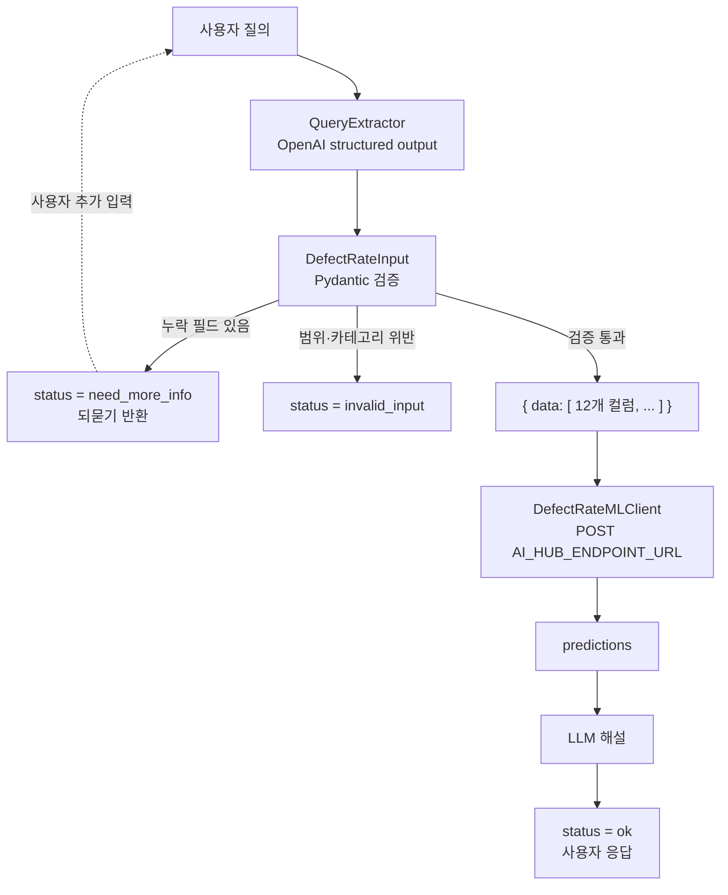

# 아키텍처 (Architecture)

사용자의 자연어 질의에서 공정 입력값을 추출해 ML API로 전달하고, 반환된 결함률 예측값을 LLM이 해설해 응답하는 파이프라인입니다.

## 1. 개요

| 항목     | 내용                                                              |
| ------ | --------------------------------------------------------------- |
| 목적     | 자연어 질의 → 결함률(%) 예측 및 해설                                         |
| 입력     | 사용자 질의 (한국어/영어, 자연어·키=값·구어체 등)                                  |
| 중간 산출물 | 12개 컬럼으로 구성된 JSON 레코드 (`{"data": [...]}`)                       |
| 출력     | `prediction(defect_rate_pct)` 예측값 + LLM 해설                      |
| 핵심 원칙  | 질의에 명시되지 않은 값은 **추측하지 않고** `null` 처리, 누락 시 **API를 호출하지 않고 되묻기** |

## 2. 전체 흐름

```
사용자 질의
   │
   ▼
[QueryExtractor]  OpenAI structured output (strict JSON Schema)
   │  · 명시되지 않은 값 = null (추측 금지)
   │  · 단위/표기 정규화, 비교 질의는 다중 레코드로 분리
   ▼
[DefectRateInput] Pydantic 검증 (타입·범위·카테고리)
   │        ├─ 누락 → status=need_more_info + 질문 반환 (API 미호출)
   │        └─ 범위 위반 → status=invalid_input
   ▼
{"data": [ {12개 컬럼}, ... ]}
   │
   ▼
[DefectRateMLClient] POST $AI_HUB_ENDPOINT_URL (재시도 + 타임아웃)
   │
   ▼
predictions: [0.0312, ...] → LLM 해설 → 사용자 응답
```



## 3. 컴포넌트 상세

### 3.1 QueryExtractor

사용자 질의에서 입력 필드를 추출하는 단계입니다. OpenAI structured output(strict JSON Schema)을 사용해 출력 형식을 스키마로 강제합니다.

- **추측 금지**: 질의에 명시되지 않은 값은 `null`로 둡니다. 특히 누락된 수치를 `0` 등으로 채우는 환각을 방지해야 합니다.
- **상대 표현 처리**: "평소보다 높다", "꽤 닳았다" 같은 표현은 수치화할 수 없으므로 `null`로 둡니다.
- **표기·단위 정규화**
  - 코드 정규화: 소문자 코드는 대문자로, "밤 근무"는 `NIGHT`, "주간조"는 `DAY`로 변환합니다.
  - 한글 단위 인식: "마이크로미터", "밀리" 등을 인식합니다.
  - 단위 환산: 코팅 두께가 mm로 들어오면 µm으로 환산(×1000)합니다. 지그 정렬 오프셋은 mm 그대로 유지합니다.
- **다중 레코드 분리**: 비교 질의(예: 공구 마모도 what-if, 라인 간 비교)는 레코드 여러 개로 분리하고, 공통 조건은 각 레코드에 복제합니다.
- **노이즈 내성**: 날짜, 부가 맥락 등 무관한 문장이 섞여도 12개 필드만 추출합니다.
- **다국어**: 영문 질의도 동일하게 처리합니다.

### 3.2 DefectRateInput (Pydantic 검증)

추출 결과를 타입, 범위, 카테고리 기준으로 검증하는 단계입니다. 필드 정의는 [`input_schema.md`](./input_schema.md)를 참고합니다.

| 검증 결과 | 처리 | `status` | ML API 호출 |
|---|---|---|---|
| 모든 필드 유효 | 레코드를 `{"data": [...]}`로 구성 | `ok` | 호출 |
| 필드 누락 (`null`) | 누락 필드를 `missing_fields`로 수집하고 질문 생성 | `need_more_info` | **미호출** |
| 범위·카테고리 위반 | 위반 필드를 알리고 재입력 요청 | `invalid_input` | **미호출** |
| 예측 요청이 아님 | 값을 지어내지 않고 입력 요청 | `need_more_info` (`out_of_scope`) | **미호출** |

- 추출 단계에서는 값이 정상적으로 뽑혔더라도 검증 단계에서 걸러질 수 있습니다. 예를 들어 공구 마모도 140%는 추출에는 성공하지만 범위(0~100) 검증에서 차단됩니다.
- 누락이 많은 경우(예: 11개 누락) 되묻기 메시지에 **입력 템플릿**을 함께 제시합니다.

### 3.3 DefectRateMLClient

검증을 통과한 JSON을 ML API로 전송하는 클라이언트입니다.

- **요청**: `POST $AI_HUB_ENDPOINT_URL`, 본문은 `{"data": [ {12개 컬럼}, ... ]}`
- **응답**: `data` 키 아래 `prediction(defect_rate_pct)` 컬럼 (단위: %)
- **안정성**: 재시도 및 타임아웃 적용 (구체적인 값은 [미결 사항](#6-미결-사항-todo) 참고)
- 레코드가 여러 개이면 요청 한 번으로 보내고, 응답의 `predictions` 순서는 요청 레코드 순서와 일치해야 합니다.

### 3.4 LLM 해설

예측값을 사용자 질의의 맥락에 맞춰 설명하는 단계입니다.

- 비교 질의는 레코드별 예측값을 나란히 비교해 해설합니다.
- 응답 내 수치는 ML API가 반환한 값만 사용합니다.

## 4. 응답 상태 (`status`)

| 값 | 의미 | ML API 호출 | 후속 동작 |
|---|---|---|---|
| `ok` | 모든 입력이 유효하고 예측 완료 | O | 예측값과 해설 반환 |
| `need_more_info` | 필수 입력이 누락되었거나 예측 요청이 아님 | X | 누락 항목 질문 반환 |
| `invalid_input` | 값이 범위·카테고리 검증에 실패 | X | 위반 필드 안내 |

## 5. 멀티턴 처리

되묻기(`need_more_info`) 이후 사용자가 부족한 값을 추가하면, 이전 턴의 값과 합쳐 다시 검증합니다. 골든 셋의 멀티턴 시나리오는 다음 세 가지입니다.

| ID | 시나리오 | 기대 동작 |
|---|---|---|
| M01 | 슬롯 채우기 | 3개 누락 → 2개 보충 후 1개 남음(`need_more_info`) → 마지막 값 입력 후 `ok` |
| M02 | what-if 후속 질의 | 예측 완료 후 "공구 마모가 90%까지 올라가면?"처럼 **특정 필드만 변경**, 나머지는 이전 값 유지 |
| M03 | 정정 | "야간조가 아니라 주간조입니다"처럼 앞 턴의 값을 **정정**하고 재예측 |

멀티턴을 위해 이전 턴의 추출 결과(레코드)를 세션 상태로 유지해야 합니다.

## 6. 미결 사항 (TODO)

문서에 반영하지 못한 구현 세부사항입니다. 확정되면 채워 주세요.

- [ ] 사용 모델명 및 structured output 스키마 버전
- [ ] ML API 재시도 횟수, 백오프 방식, 타임아웃 값
- [ ] ML API 오류(4xx/5xx, 타임아웃) 발생 시 사용자 응답 정책
- [ ] 세션 상태 저장 위치와 만료 정책 (멀티턴)
- [ ] `tool_wear_pct` 외 필드의 범위·카테고리 허용값 (스키마 기준)
- [ ] 한 번에 허용하는 최대 레코드 수
- [ ] 예측값 표기 단위 (응답 예시 `0.0312`는 소수, 컬럼명은 `%`) 확인 필요

## 7. 테스트 (골든 셋)

`data/golden_set.json`의 케이스가 각 단계의 동작을 검증합니다. 스키마·세션·파싱은 `test/test_core.py`가 담당합니다.

| 검증 대상 | 케이스 |
|---|---|
| 회귀 기준 (실측 검증값 `1.6498678908`) | G01 |
| 표기 다양성 (자연어, 키=값, 구어체, 영문, 노이즈) | G01, G02, G03, G12, G13 |
| 누락 처리·되묻기 | G04, G05, G06 |
| 환각 저항성 (상대 표현, 무관 질의) | G09, G14 |
| 범위 검증 | G10 |
| 단위 환산 | G03, G11 |
| 다중 레코드 분리 | G07, G08 |
| 멀티턴 | M01, M02, M03 |