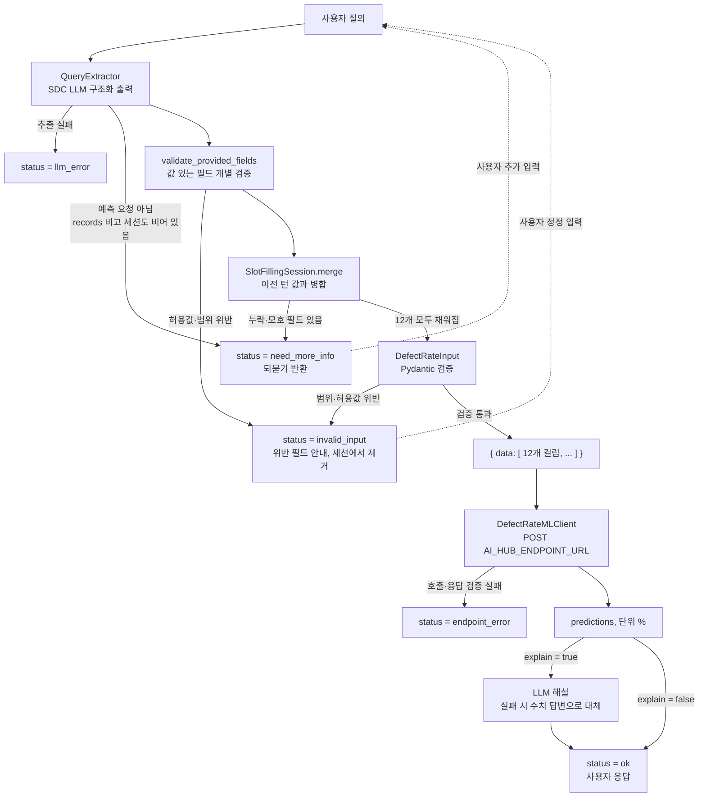

# 아키텍처 (Architecture)

사용자의 자연어 질의에서 공정 입력값을 추출해 ML API로 전달하고, 반환된 결함률 예측값을 LLM이 해설해 응답하는 파이프라인입니다.

## 1. 개요

| 항목 | 내용 |
|---|---|
| 목적 | 자연어 질의 → 결함률(%) 예측 및 해설 |
| 입력 | 사용자 질의 (한국어/영어, 자연어·키=값·구어체·JSON 붙여넣기 등) |
| 중간 산출물 | 12개 컬럼으로 구성된 JSON 레코드 (`{"data": [...]}`) |
| 출력 | `prediction(defect_rate_pct)` 예측값(단위 %) + LLM 해설(`explain=false`이면 생략) |
| 핵심 원칙 | 질의에 명시되지 않았거나 **모호한** 값은 **추측하지 않고** `null` 처리, 누락·모호 시 **API를 호출하지 않고 되묻기** |

## 2. 전체 흐름

```
사용자 질의
   │
   ▼
[QueryExtractor]  SDC LLM 구조화 출력 (json_schema → json_object → prompt 폴백)
   │  · 명시되지 않은 값 = null (추측 금지)
   │  · 모호한 값 = null + ambiguous_fields 표시
   │  · 단위/표기 정규화, 수치 반올림, 비교 질의는 다중 레코드로 분리
   │        ├─ LLM 호출·파싱 실패 → status=llm_error
   │        └─ records=[] 이고 세션도 비어 있음 → status=need_more_info (12개 전체 안내)
   ▼
[validate_provided_fields] 값이 있는 필드만 개별 검증 (슬롯이 덜 차도 실행) <!-- [추가] 2026-10-23 -->
   │        └─ 허용값·범위 위반 → status=invalid_input, 위반 필드는 세션에 저장하지 않음 (API 미호출)
   ▼
[이미 확인된 필드가 모호해졌으면 세션 슬롯 제거] <!-- [추가] 2026-10-26 로직, 2026-10-27 문서화: pipeline.py run() -->
   ▼
[SlotFillingSession.merge] 이전 턴의 확인값과 병합
   │        └─ null 필드 있음(누락·모호) → status=need_more_info + 질문 반환 (API 미호출)
   ▼
[DefectRateInput] Pydantic 검증 (타입·범위·허용값) — 12개가 모두 찬 경우에만 도달 (필드 단위 검증을 통과한 값에 대한 최종 안전망)
   │        └─ 범위·허용값 위반 → status=invalid_input, 위반 값은 세션에서 제거 (API 미호출)
   ▼
{"data": [ {12개 컬럼}, ... ]}
   │
   ▼
[DefectRateMLClient] POST $AI_HUB_ENDPOINT_URL (재시도 + 타임아웃 + 에코 검증)
   │        └─ 호출·응답 검증 실패 → status=endpoint_error
   ▼
predictions: [1.6498…, ...] (단위 %) → LLM 해설(선택) → status=ok
```



## 3. 컴포넌트 상세

### 3.1 QueryExtractor

사용자 질의에서 입력 필드를 추출하는 단계입니다. Siemens SDC LLM 게이트웨이(OpenAI 호환 `chat/completions`)를 호출합니다. <!-- [수정] 2026-10-22: 실제 구조화 출력 폴백 동작 반영 -->

- **구조화 출력 방식**: 설정 `llm_json_mode`(기본 `auto`)이면 `json_schema`(strict) → `json_object` → `prompt` 순서로 시도하고, 처음 성공한 방식을 프로세스가 살아 있는 동안 고정합니다. 서버가 스키마를 강제하는 것은 `json_schema` 모드뿐이고, 폴백 모드에서는 JSON 파싱만 하며 스키마 일치는 검증하지 않습니다. 그래서 `QueryExtractor`가 코드에서 다시 보정합니다: 빠진 키는 null, 타입 변환 실패·bool·NaN·inf는 null, 알 수 없는 `ambiguous_fields` 이름은 제거.

- **추측 금지**: 질의에 명시되지 않은 값은 `null`로 둡니다. 특히 누락된 수치를 `0` 등으로 채우는 환각을 방지해야 합니다.
- **모호한 값 처리**: 아래 유형은 값을 하나로 확정할 수 없으므로 `null`로 두고, 해당 필드를 `ambiguous_fields`에 표시합니다.

  | 유형 | 예시 | 처리 |
  |---|---|---|
  | 정성·상대 표현 | "평소보다 높다", "마모가 많이 진행됐다", "얼마 전에 정비" | `null` |
  | 범위 표현 | "습도 50에서 60% 사이", "460~470개" | `null` (평균·중간값으로 확정 금지) |
  | 단위 없는 값 | 코팅 두께 "0.08" (mm인지 µm인지 불명) | `null` |
  | 미확정 코드 | "BPR 라인 중 한 곳", "저녁 근무", "오후조", "공급사는 A나 B" | `null` |
  | 질의 내 번복 | "44.2%라고 했는데 54.2%였나" | `null` |
  | 필드를 지목한 기준 참조 | "습도는 평소와 같아요" | `null` (`ambiguous_fields`에 포함) |

  <!-- [수정] 2026-10-27 (문서 변경, 로직 변경 없음): input_schema.md 2026-10-26 정정과 동일하게, 필드를 지목하지 않은 참조는 ambiguous_fields에 들어가지 않는다는 점을 반영해 아래 항목으로 분리했다 (llm.py [불확실한 값]의 B). 이전에는 "기준 없는 참조"로 뭉뚱그려 ambiguous_fields에 포함되는 것처럼 보였다. -->
  - **필드를 지목하지 않은 기준 참조**(예: "평소랑 비슷한 조건")는 어느 필드인지 특정할 수 없어 `ambiguous_fields`에 넣지 않습니다. 프롬프트는 이 경우 해당 발화로 언급된 필드를 모두 `null`로 두고, `notes`에 "기준 조건을 알 수 없어 반영하지 않았습니다." 같은 사유를 남기도록 지시합니다. 상세 예시는 [`input_schema.md`](./input_schema.md)의 "모호한 값"을 참고합니다.
  - **세션에 이미 확인된 필드를 모호하게 다시 바꾸려는 발화** <!-- [추가] 2026-10-26 로직, 2026-10-27 문서화: pipeline.py run() 반영 -->: 예를 들어 습도 54.49%가 이미 확인된 상태에서 "습도가 꽤 높아졌다면?"처럼 되물으면, 추출 단계는 해당 필드를 `null` + `ambiguous_fields`로 내보냅니다. 파이프라인은 이를 받아 세션에 저장돼 있던 그 필드의 값을 즉시 비우므로(세션 병합 전), 기존 값으로 조용히 예측되지 않고 `missing_fields`·`ambiguous_fields`에 다시 올라 되묻습니다(다른 확인값은 유지, ML 미호출). 자세한 흐름은 [`architecture-pt2.md`](./architecture-pt2.md)의 "검증 결과별 처리"를 참고합니다. 골든 셋(v3)에는 이 경우의 단일 턴 케이스가 없어, 실제 LLM이 프롬프트대로 `ambiguous_fields`를 내는지는 회귀 테스트(대역 추출)로만 확인됩니다.

- **표기·단위 정규화**
  - 코드 정규화: 소문자 코드는 대문자로, "밤 근무"·"야간조"·"night shift"는 `NIGHT`, "주간조"·"day shift"는 `DAY`로 변환합니다. "저녁 근무"·"오후조"는 변환하지 않고 모호한 값으로 처리합니다.
  - 한글 단위 인식: "퍼센트"(%), "마이크로미터"(µm), "밀리"(mm) 등을 인식합니다.
  - 단위 환산 <!-- [수정] 2026-10-23: 코팅 두께(mm→µm)만 환산하던 규칙을 모든 필드로 확장 -->: 사용자가 필드의 기준 단위와 다른 단위로 입력해도 LLM이 기준 단위로 환산한 값을 추출합니다. 예: 코팅 0.0984mm → 98.4µm, 지그 정렬 오차 0.02cm → 0.2mm, 정비 후 2주 → 14일, 1.2천 개 → 1200. 필드별 환산표는 [`input_schema.md`](./input_schema.md)의 "단위 환산"을 참고합니다. 필드와 맞지 않는 단위(습도 5mm)나 환산 불가 단위(시간·개월)는 모호한 값으로 처리합니다. 환산했으면 `notes`에 원래 표현과 환산값을 남기도록 지시합니다.
  - 항목 표시가 없는 값 <!-- [추가] 2026-10-23; [수정] 2026-10-27 (문서 변경, 로직 변경 없음): llm.py 재확인 결과 현재 프롬프트에 번호 규칙("규칙 2-1")이 없어 실제 절 이름으로 정정 -->: 필드명 없이 값만 적힌 입력은 다음 기준으로 매칭합니다. 판단은 LLM 프롬프트(`[항목명 없는 값의 필드 결정]` 절)가 하며, 확인된 값이 있는 대화에서는 `build_extraction_user_content()`가 `[아직 필요한 값]` 목록(`known`에 없는 필드)을 추출 요청에 함께 보냅니다.
    - 문자 값: 형태로 필드가 정해지면 매칭합니다 (`LINE-…` → `production_line`, `SIM-SUP-…` → `supplier_code`, DAY/NIGHT/주간/야간 → `shift`). 허용값 밖 코드도 해당 필드로 보고 검증 단계에서 차단합니다.
    - 수치 값: `[아직 필요한 값]` 중 값의 단위와 호환되는 수치 필드가 **정확히 1개**일 때만 매칭합니다. 예: 남은 필드가 `supplier_code`와 `planned_quantity`뿐이면 "SIM-SUP-B, 480"을 각각 매칭합니다. 후보가 2개 이상이거나 ~~첫 발화(목록 없음)이면~~ 추측하지 않고 버리며 `notes`로 사유를 알립니다.
    - 예외: 단위 없는 수치는 코팅 두께의 유일한 후보여도 매칭하지 않고 모호한 값으로 처리합니다 (A03).
  - 반올림: 환산은 LLM이 하므로 `98.39999…` 같은 부동소수점 오차가 생길 수 있습니다. `QueryExtractor._coerce`가 실수 필드는 소수점 6자리로, 정수 필드(수량, 정비 경과일)는 정수로 반올림합니다. <!-- [수정] 2026-10-22: 반올림 구현 반영 (이전: 추정·확인 필요) -->
- **허용값 밖의 코드**: `LINE-BPR-03`, `SIM-SUP-D`처럼 허용값에 없는 코드는 가장 비슷한 값으로 치환하지 않고 입력된 그대로 넘겨 검증 단계에서 차단합니다. 그래서 추출 스키마의 범주형 필드는 `enum`이 아닌 자유 문자열입니다(골든 I04·I05).
- **다중 레코드 분리**: 비교 질의(예: 공구 마모도 what-if, 라인 간 비교)는 레코드 여러 개로 분리하고, 공통 조건은 각 레코드에 복제합니다. 공통으로 누락된 필드는 모든 레코드에서 `null`입니다.
- **노이즈 내성**: 날짜, 부가 맥락 등 무관한 문장이 섞여도 12개 필드만 추출합니다.
- **입력 형식**: 자연어, 키=값 나열, JSON 붙여넣기, 영문 질의를 동일하게 처리합니다.
- **records 구성 규칙**
  - 예측 의도가 있는 질의: 레코드 1개 이상. 값이 전혀 없으면 12개 필드가 모두 `null`인 레코드 1개
  - 예측 요청이 아닌 질의(범위 밖): `records = []`
  - 예측 의도 판단 기준 <!-- [추가] 2026-10-22: 골든 셋에서 암묵적이던 기준을 명시 -->
    - "결함률 예측" 같은 문구 없이 공정 조건만 나열해도 예측 의도로 봅니다 (A01~A05, A07, P08).
    - 예측에 필요한 입력을 묻는 질문도 예측 의도로 보고 전 필드 `null` 레코드를 둡니다 (N04).
    - 공정·예측과 무관한 질의만 범위 밖으로 봅니다 (N05).

### 3.2 DefectRateInput (Pydantic 검증)

추출 결과를 타입, 범위, 허용값 기준으로 검증하는 단계입니다. 필드 정의 전체는 [`input_schema.md`](./input_schema.md)를 참고합니다.

**유효값 제약 (하드 제약)**

| 필드 | 제약 |
|---|---|
| `production_line` | `LINE-BPR-01`, `LINE-BPR-02` (이 2종뿐) |
| `shift` | `DAY`, `NIGHT` |
| `supplier_code` | `SIM-SUP-A`, `SIM-SUP-B`, `SIM-SUP-C` |
| `fixture_alignment_offset_mm` | 0 이상 (0은 유효, 음수는 위반) |
| `tool_wear_pct` | 0 이상 100 이하 (0, 100은 유효) |

**현재 코드의 추가 검사 (사양 미확정)** <!-- [수정] 2026-10-22: 사양에 없지만 DefectRateInput이 차단하는 범위를 명시 -->

그 외 수치 필드는 사양상 하드 제약이 확정되지 않았습니다. 다만 현재 `DefectRateInput`은 아래 범위를 추가로 검사해, 벗어나면 `invalid_input`으로 차단합니다. 골든 셋(v3, I01~I12 포함)에는 이 검사에 걸리는 케이스가 없고 <!-- [수정] 2026-10-27 (문서 변경, 로직 변경 없음): 골든 v2 -> v3 표기 정정, data/golden_set_v3.csv의 I06~I12를 직접 대조해 확인 -->, 유지 여부는 [미결 사항](#6-미결-사항-todo)에서 관리합니다.

| 필드 | 현재 코드 검사 |
|---|---|
| `planned_quantity` | 0 이상 (정수) |
| `ambient_humidity_pct` | 0 이상 100 이하 |
| `incoming_material_quality_score` | 0 이상 100 이하 |
| `coating_target_thickness_um` | 0 이상 |
| `weld_energy_setting_pct` | 0 이상 150 이하 |
| `process_setting_deviation_pct` | 범위 검사 없음 (음수 허용) |
| `days_since_maintenance` | 0 이상 (정수) |
