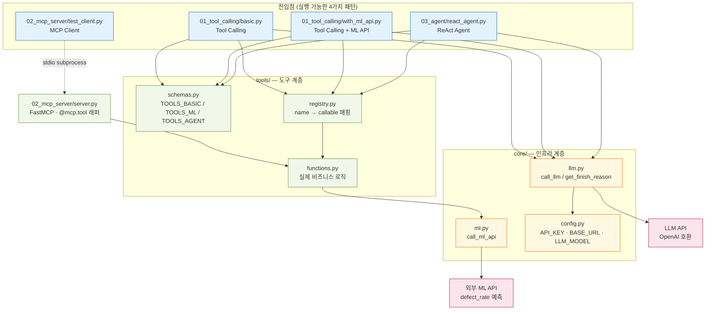

# Architecture — Agent Learning

Tool Calling → MCP → ReAct Agent 세 개념의 동작 원리와 이 프로젝트의 구체적인 구현 로직을 설명합니다.

---

## 1. 개념 요약

### 1-1. Tool Calling

LLM이 외부 함수를 "직접 실행"하지 않는다는 점이 핵심입니다.

```
LLM 역할 : "어떤 함수를, 어떤 인자로 호출할지" 를 JSON으로 선언
앱 역할  : 그 JSON을 읽고 실제 함수를 실행, 결과를 LLM에게 전달
```

LLM은 실행 결과를 볼 수 없습니다. 앱 코드가 결과를 `role="tool"` 메시지로 대화 히스토리에 추가해야 LLM이 다음 답변에서 그 결과를 활용할 수 있습니다.

Tool 안에는 어떤 로직이든 담을 수 있습니다.

- 외부 REST API 호출 (ML 예측, 날씨 조회 등)
- DB 조회·수정
- 파일 읽기·쓰기
- 알림 발송 등

### 1-2. MCP (Model Context Protocol)

Tool Calling의 "도구 연결" 부분을 USB 규격처럼 표준화한 프로토콜입니다.

|                | 일반 Tool Calling              | MCP                                                    |
| -------------- | ------------------------------ | ------------------------------------------------------ |
| 도구 정의      | 앱마다 JSON Schema를 직접 작성 | `@mcp.tool()` 데코레이터로 자동 생성                 |
| 클라이언트     | 해당 앱에서만 사용 가능        | Claude Desktop, Cursor 등 모든 MCP 클라이언트에서 사용 |
| 도구 목록 조회 | 코드에 하드코딩                | `session.list_tools()` 로 런타임에 동적 조회         |

MCP에서도 "어떤 도구를 선택할지"는 여전히 LLM이 결정합니다. MCP는 선택 주체가 아니라, 도구 목록을 표준 포맷으로 광고(advertise)하는 통신 규격입니다.

### 1-3. AI Agent (ReAct 패턴)

단순 Tool Calling이 "질문 → 도구 1번 → 답변"이라면, Agent는 "목표 → 도구 N번 반복 → 최종 답변"입니다.

```
Thought    LLM이 현재 상황을 분석하고 다음 행동을 계획
Action     선택한 도구를 호출 (또는 최종 답변 결정)
Observation 도구 결과를 대화 맥락에 추가
→ Thought로 돌아가 반복
```

개발자가 순서를 하드코딩하지 않아도 됩니다. LLM이 목표를 보고 스스로 단계를 분해하고 순서를 결정합니다.

---

## 2. Tool Calling 상세 흐름

### 구현 위치: `01_tool_calling/basic.py`

**예시 질의**: "야간 2라인의 결함률을 조회하고, 2.5%를 초과하면 HIGH 심각도로 알림 보내줘"

#### Step 1 — 도구 정의 (`tools/schemas.py`, `tools/functions.py`)

앱 코드가 LLM에게 "이런 함수를 쓸 수 있다"고 알려주기 위해 JSON Schema를 작성합니다.

```python
# tools/schemas.py
SCHEMA_GET_SHIFT_STATS = {
    "type": "function",
    "function": {
        "name": "get_shift_stats",
        "description": "교대조와 생산 라인의 과거 평균 결함률을 조회합니다.",
        "parameters": {
            "properties": {
                "shift":           {"type": "string", "enum": ["DAY", "NIGHT"]},
                "production_line": {"type": "string", "enum": ["LINE-BPR-01", "LINE-BPR-02"]},
            },
            "required": ["shift", "production_line"],
        },
    },
}
```

실제 함수는 `tools/functions.py`에 별도로 구현되어 있습니다.

#### Step 2 — 1차 LLM 호출

```
messages = [system 프롬프트, user 질의]
tools    = [get_shift_stats 스키마, create_alert 스키마]
         ↓
call_llm(messages, tools)
```

LLM 응답:

```json
{
  "finish_reason": "tool_calls",
  "message": {
    "content": null,
    "tool_calls": [{
      "id": "call_abc123",
      "function": {
        "name": "get_shift_stats",
        "arguments": "{\"shift\": \"NIGHT\", \"production_line\": \"LINE-BPR-02\"}"
      }
    }]
  }
}
```

`finish_reason: "tool_calls"` → LLM이 도구 호출을 요청했다는 신호.
LLM은 함수를 실행하지 않았습니다. JSON을 반환했을 뿐입니다.

#### Step 3 — 앱 코드가 함수 실행 (`tools/registry.py`)

```python
# basic.py:91~108 (앱 코드가 직접 실행)
tool_name = "get_shift_stats"
tool_args = {"shift": "NIGHT", "production_line": "LINE-BPR-02"}

execute_tool(tool_name, tool_args, REGISTRY_BASIC)
  → REGISTRY_BASIC["get_shift_stats"](**tool_args)
    → functions.get_shift_stats("NIGHT", "LINE-BPR-02")
      → {"avg_defect_pct": 2.91, "avg_quantity": 471, "sample_count": 158}
```

결과를 `role="tool"` 메시지로 히스토리에 추가:

```python
messages.append({
    "role":         "tool",
    "tool_call_id": "call_abc123",   # LLM이 어느 호출의 결과인지 매핑
    "content":      '{"avg_defect_pct": 2.91, ...}',
})
```

#### Step 4 — 2차 LLM 호출

이제 messages = `[system, user, assistant(tool_calls), tool결과]`.

LLM은 결함률 2.91% > 2.5% 임을 판단하고 다음 도구를 선택합니다:

```json
{
  "finish_reason": "tool_calls",
  "message": {
    "tool_calls": [{
      "function": {
        "name": "create_alert",
        "arguments": "{\"message\": \"야간 2라인 결함률 2.91%, 임계치 초과\", \"severity\": \"HIGH\"}"
      }
    }]
  }
}
```

앱 코드가 `create_alert` 실행 → 콘솔에 알림 출력.

#### Step 5 — 3차 LLM 호출 (최종 답변)

`finish_reason: "stop"` → 루프 종료. LLM이 지금까지의 결과를 종합해 한국어 답변을 생성합니다.

#### 전체 흐름 다이어그램

```
사용자: "야간 2라인 결함률 조회, 2.5% 초과하면 HIGH 알림"
  │
  ▼
[1차 LLM 호출] ── tools 스키마 전달
  │  finish_reason="tool_calls"
  │  → get_shift_stats(NIGHT, LINE-BPR-02) 선택
  ▼
[앱 코드: execute_tool]
  │  → functions.get_shift_stats() 실행
  │  → {"avg_defect_pct": 2.91, ...}
  │  → messages에 role="tool" 추가
  ▼
[2차 LLM 호출] ── 도구 결과 포함된 messages 전달
  │  finish_reason="tool_calls"
  │  → 2.91% > 2.5% 판단
  │  → create_alert(severity=HIGH) 선택
  ▼
[앱 코드: execute_tool]
  │  → functions.create_alert() 실행
  │  → 알림 발송
  │  → messages에 role="tool" 추가
  ▼
[3차 LLM 호출]
  │  finish_reason="stop"
  ▼
최종 답변: "야간 2라인의 결함률은 2.91%로 임계치(2.5%)를 초과하여 HIGH 알림을 발송했습니다."
```

---

## 3. ML API 연동 Tool Calling

### 구현 위치: `01_tool_calling/with_ml_api.py`

**예시 질의**: "1라인 주간조, A공급사, 오늘 480개 계획. 습도 58%, 자재 품질 82점, 코팅 75um, 용접 92%, 지그 오프셋 0.15mm, 공정 편차 +1.8%, 공구 마모 35%, 정비 3주 전이야. 결함률 예측해줘."

basic.py와 흐름은 동일하지만, Tool 내부에서 외부 ML API를 호출한다는 점이 다릅니다.

```
[1차 LLM 호출]
  자연어 → 12개 파라미터 추출
  → predict_defect_rate(production_line="LINE-BPR-01", shift="DAY",
                        supplier_code="SIM-SUP-A", planned_quantity=480,
                        ambient_humidity_pct=58.0, ..., days_since_maintenance=21) 선택

[앱 코드: execute_tool]
  → functions.predict_defect_rate(12개 파라미터)
    → core/ml.call_ml_api(row)         ← 외부 AI Hub POST 요청
      → {"data": [{..., "prediction(defect_rate_pct)": 2.14}]}
  → {"mode": "real", "prediction_defect_rate_pct": 2.14}

[2차 LLM 호출]
  예측값 2.14%를 받아 한국어 해설 답변 생성
```

LLM이 한국어에서 필드명·단위 변환까지 처리합니다:

- "1라인" → `LINE-BPR-01`
- "주간조" → `DAY`
- "3주 전" → `days_since_maintenance=21`
- "A공급사" → `SIM-SUP-A`

---

## 4. MCP 상세 흐름

### 구현 위치: `02_mcp_server/server.py`, `02_mcp_server/test_client.py`

#### 서버 측: 도구 등록 (`server.py`)

`@mcp.tool()` 데코레이터 하나로 함수 시그니처와 docstring이 자동으로 MCP Tool Schema로 변환됩니다. JSON Schema를 직접 작성할 필요가 없습니다.

```python
# server.py
@mcp.tool()
def get_shift_stats(shift: str, production_line: str) -> dict:
    """
    특정 교대조와 생산 라인의 과거 6개월 평균 결함률을 조회합니다.
    Args:
        shift: 교대조 (DAY 또는 NIGHT)
        production_line: 생산 라인 코드 (LINE-BPR-01 또는 LINE-BPR-02)
    """
    return _get_shift_stats(shift=shift, production_line=production_line)
```

실제 비즈니스 로직은 `tools/functions.py`에 위임합니다. 서버는 얇은 래퍼(thin wrapper)입니다.

#### 클라이언트 측: 도구 목록 조회 → 호출 (`test_client.py`)

```python
# 1. 세션 초기화 (프로토콜 버전 협상)
await session.initialize()

# 2. 서버가 광고하는 도구 목록 동적 조회
tools = await session.list_tools()
# → [predict_defect_rate, get_shift_stats, create_quality_alert]

# 3. 도구 직접 호출
result = await session.call_tool(
    "get_shift_stats",
    arguments={"shift": "DAY", "production_line": "LINE-BPR-01"},
)
```

`test_client.py`는 `StdioServerParameters`를 통해 `server.py`를 subprocess로 자동 실행합니다. 별도 터미널 없이 단일 명령으로 테스트 가능합니다.

#### MCP 연결 흐름 다이어그램

```
test_client.py 실행
  │
  ├─ StdioServerParameters → server.py를 subprocess로 실행
  │
  ▼
[초기화] session.initialize()
  │  클라이언트 ↔ 서버 프로토콜 버전 협상
  ▼
[도구 조회] session.list_tools()
  │  서버: "나는 predict_defect_rate, get_shift_stats, create_quality_alert 를 제공합니다"
  │  클라이언트: 목록 수신
  ▼
[도구 호출] session.call_tool("get_shift_stats", {...})
  │  서버: tools/functions.get_shift_stats() 실행
  │  결과를 MCP 표준 포맷으로 반환
  ▼
result.content[0].text  → '{"avg_defect_pct": 1.82, ...}'
```

#### MCP의 장점

Claude Desktop 또는 Cursor에서도 동일한 `server.py`에 연결할 수 있습니다. 각 클라이언트마다 Tool Schema를 새로 작성할 필요가 없습니다.

```json
// Claude Desktop 설정 예시
{
  "mcpServers": {
    "defect-predictor": {
      "command": "python",
      "args": ["/home/jywoo/siemens/agent-learning/02_mcp_server/server.py"]
    }
  }
}
```

---

## 5. ReAct Agent 상세 흐름

### 구현 위치: `03_agent/react_agent.py`

**예시 질의**: "1라인과 2라인의 주간·야간 교대조 결함률을 모두 조회하고, 결과를 비교해줘. 2.5%를 초과하는 조합은 HIGH 심각도로 알림을 발송해줘."

Agent는 목표를 받으면 스스로 단계를 분해합니다. 개발자가 "4번 조회 → 비교 → 알림"을 하드코딩하지 않아도 됩니다.

#### 실제 실행 흐름 (Step별)

```
🎯 목표: 1·2라인 주·야간 전체 조회 + 2.5% 초과 알림

── STEP 1 ──────────────────────────────────────────
💭 Thought: "2개 라인 × 2교대 = 4개 조합을 모두 조회해야 함. 먼저 1라인 주간부터."
⚙️  Action: get_shift_stats(shift="DAY", production_line="LINE-BPR-01")
📋 Obs:    {"avg_defect_pct": 1.82, "avg_quantity": 523, "sample_count": 180}

── STEP 2 ──────────────────────────────────────────
⚙️  Action: get_shift_stats(shift="DAY", production_line="LINE-BPR-02")
📋 Obs:    {"avg_defect_pct": 2.14, "avg_quantity": 497, "sample_count": 162}

── STEP 3 ──────────────────────────────────────────
⚙️  Action: get_shift_stats(shift="NIGHT", production_line="LINE-BPR-01")
📋 Obs:    {"avg_defect_pct": 2.45, "avg_quantity": 488, "sample_count": 174}

── STEP 4 ──────────────────────────────────────────
⚙️  Action: get_shift_stats(shift="NIGHT", production_line="LINE-BPR-02")
📋 Obs:    {"avg_defect_pct": 2.91, "avg_quantity": 471, "sample_count": 158}

── STEP 5 ──────────────────────────────────────────
💭 Thought: "2.5% 초과: NIGHT/LINE-BPR-01(2.45% → 미만), NIGHT/LINE-BPR-02(2.91% → 초과).
            야간 1라인은 경계값이므로 재확인. 야간 2라인에 HIGH 알림 발송."
⚙️  Action: create_alert(message="야간 2라인 결함률 2.91%", severity="HIGH",
                         production_line="LINE-BPR-02")
📋 Obs:    {"status": "sent", "alert_id": "ALERT-1234567890"}

── STEP 6 ──────────────────────────────────────────
finish_reason="stop" → 최종 답변 도출

🤖 최종 보고서:
| 조합                  | 평균 결함률 | 임계치 초과 |
|-----------------------|------------|------------|
| 주간 1라인 (LINE-01)  | 1.82%      | -          |
| 주간 2라인 (LINE-02)  | 2.14%      | -          |
| 야간 1라인 (LINE-01)  | 2.45%      | -          |
| 야간 2라인 (LINE-02)  | 2.91%      | ⚠️ HIGH 알림 발송 |
```

#### 루프 구조 (`react_agent.py:91~132`)

```python
while step < MAX_STEPS:          # 최대 15 스텝 (무한 루프 방지)
    response = call_llm(messages, tools=TOOLS_AGENT)
    finish_reason = get_finish_reason(response)

    if finish_reason != "tool_calls":
        break                    # 최종 답변 → 루프 종료

    # Thought 출력 (content가 있을 때만)
    if message.get("content"):
        print(f"💭 Thought: {message['content']}")

    # Action + Observation
    for tc in tool_calls:
        result = execute_tool(tc["function"]["name"], args, REGISTRY_AGENT)
        messages.append({"role": "tool", "tool_call_id": tc["id"], "content": result})
```

대화 히스토리(`messages`)에 도구 결과가 쌓이면서 LLM이 맥락을 이어갑니다. `MAX_STEPS=15`를 초과하면 "지금까지의 결과를 종합해달라"는 메시지를 추가해 강제 종료합니다.

---

## 6. 세 개념 비교

|                | Tool Calling (basic)         | Tool Calling (ML)                  | MCP                      | ReAct Agent                 |
| -------------- | ---------------------------- | ---------------------------------- | ------------------------ | --------------------------- |
| 도구 호출 횟수 | 1~2회                        | 1회                                | 직접 호출                | N회 (자율 결정)             |
| 도구 선택 주체 | LLM                          | LLM                                | LLM (목록은 서버가 제공) | LLM                         |
| 실제 실행 주체 | 앱 코드                      | 앱 코드                            | MCP 서버                 | 앱 코드                     |
| 계획 주체      | 없음 (단발)                  | 없음 (단발)                        | 없음 (단발)              | LLM이 스스로 분해           |
| Tool 내부      | mock 함수                    | 외부 ML API 호출                   | 비즈니스 로직 위임       | mock + ML API + 알림        |
| 구현 파일      | `01_tool_calling/basic.py` | `01_tool_calling/with_ml_api.py` | `02_mcp_server/`       | `03_agent/react_agent.py` |

---

## 7. 모듈 의존 관계

```
01_tool_calling/basic.py
  └─ tools/schemas.py    TOOLS_BASIC  (스키마 그룹)
  └─ tools/registry.py   REGISTRY_BASIC → tools/functions.py
  └─ core/llm.py         call_llm, get_finish_reason, get_message
       └─ core/config.py API_KEY, BASE_URL, LLM_MODEL

01_tool_calling/with_ml_api.py
  └─ tools/schemas.py    TOOLS_ML
  └─ tools/registry.py   REGISTRY_ML → tools/functions.py → core/ml.py
  └─ core/llm.py

02_mcp_server/server.py
  └─ tools/functions.py  (직접 import, @mcp.tool() 래퍼만 추가)
  └─ mcp[cli]            FastMCP

02_mcp_server/test_client.py
  └─ server.py           (subprocess로 자동 실행)
  └─ mcp                 ClientSession, StdioServerParameters

03_agent/react_agent.py
  └─ tools/schemas.py    TOOLS_AGENT
  └─ tools/registry.py   REGISTRY_AGENT → tools/functions.py → core/ml.py
  └─ core/llm.py
```

---

## 8. 도식화

1) 전체 아키텍처: 핵심 메시지는 "모든 패턴이 tools/functions.py 하나를 공유한다" 입니다. MCP 서버조차 얇은 래퍼라는 점이 그림에서 바로 보이도록 배치했습니다.



2) Tool Calling 흐름 (시퀀스)

```mermaid
sequenceDiagram
    autonumber
    actor U as 사용자
    participant App as basic.py<br/>(앱 코드)
    participant LLM as LLM
    participant F as tools/functions.py

    U->>App: "야간 2라인 결함률 조회,<br/>2.5% 초과 시 HIGH 알림"

    rect rgb(232, 244, 253)
    Note over App,LLM: 1차 호출 — 도구 선택
    App->>LLM: call_llm(messages, tools=TOOLS_BASIC)
    LLM-->>App: finish_reason="tool_calls"<br/>get_shift_stats(NIGHT, LINE-BPR-02)
    Note right of LLM: LLM은 실행하지 않음<br/>JSON 선언만 반환
    end

    App->>F: execute_tool() → get_shift_stats()
    F-->>App: {"avg_defect_pct": 2.91, ...}
    App->>App: messages.append(role="tool",<br/>tool_call_id="call_abc123")

    rect rgb(241, 248, 233)
    Note over App,LLM: 2차 호출 — 결과 판단 후 다음 도구
    App->>LLM: call_llm(messages + tool 결과)
    LLM-->>App: 2.91% > 2.5% 판단<br/>create_alert(severity="HIGH")
    end

    App->>F: execute_tool() → create_alert()
    F-->>App: {"status": "sent", "alert_id": "..."}
    App->>App: messages.append(role="tool")

    rect rgb(255, 248, 225)
    Note over App,LLM: 3차 호출 — 최종 답변
    App->>LLM: call_llm(messages)
    LLM-->>App: finish_reason="stop"
    end

    App-->>U: "야간 2라인 결함률 2.91%,<br/>임계치 초과로 HIGH 알림 발송"
  ```
